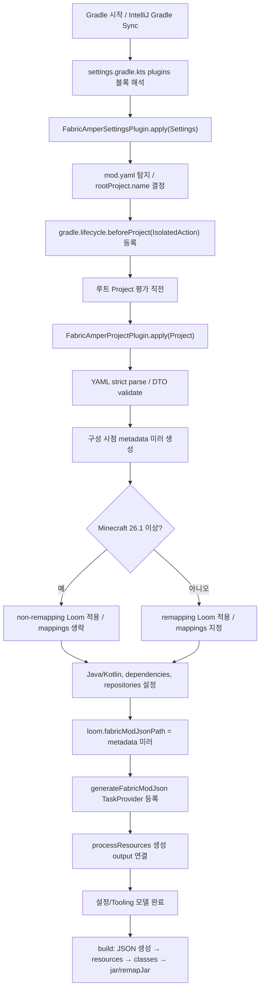

# Fabric Amper — 구현 청사진 (`specs.md`)

**원본 설계 기준일:** 2026-11-11. **현재 개발 계약 기준일:** 2026-11-18 (§12.12.7 추가). **이력 구분:** 기존 §1–§11의 `schema: 1`, `0.1.0`, 최초 구현 전제 및 “아직 검증 없음” 등의 서술은 **당시 설계 기록**이다. 현행 `main`의 실제 입력·기능 계약은 §12, 특히 §12.1·§12.8·§12.12를 우선한다. **현행 스키마 생략 기본값은 1.1**이며, 과거 v1을 선택하려면 `schema: 1`을 명시해야 한다. 공개 v0.2.0의 사용 계약을 소급 변경하지 않으며, **v0.3.0 GitHub 프리릴리즈는 2026-11-17에 게시되었고, 9개 자산 해시와 JitPack 공개 소비자 빌드가 검증되었다.** §12.12.5의 소비자 TestKit 및 공개 JitPack 빌드 PASS를 Minecraft 게임 실행·IntelliJ GUI Sync·전체 출하 승인으로 해석하지 않는다. **v0.3.1은 2026-11-18 프리릴리즈 준비 대상으로, 새 릴리즈 자산과 JitPack 성공 검증을 완료한 것으로 기록하지 않는다.**

## 1. 사용자 계약·기술적 사실

Fabric Amper는 Fabric 모드가 아니라 **Gradle binary plugin**이다. 개발자에게 필요한 빌드 설정은 프로젝트 루트의 `mod.yaml`(또는 `mod.yml`) 하나이며 `settings.gradle.kts`는 플러그인 해석을 위한 최소 진입점이다. 개발자 프로젝트에 `build.gradle`/`build.gradle.kts`를 생성하거나 요구하지 않는다. `Settings`/`Project`/Fabric Loom API를 프로그램으로 구성한다. `fabric.mod.json`은 개발자가 직접 만들지 않는다. Loom의 설정 단계 읽기용 **관리형 미러(`.gradle/`)** 및 Gradle의 **태스크 생성 출력(`build/`)**을 사용하되 최종 모드 JAR 루트에는 정확히 하나만 포함한다.

검증 가능한 공식 사실과 본 프로젝트의 설계 선택을 구분한다.

| 질문 | 공식 확인된 사실 | Fabric Amper 설계 |
| --- | --- | --- |
| Minecraft 26.3용 Loom | MC 26.1+는 비난독화. 플러그인 ID `net.fabricmc.fabric-loom`, `mappings` 의존성 불필요, `jar` 사용 | 26.3을 기본 프로파일 |
| 과거 Yarn 지원 | 1.21.11 이하 난독화 버전은 `net.fabricmc.fabric-loom-remap` + `mappings` | 명확히 분리된 레거시 프로파일 |
| Modrinth | Maven URL `https://api.modrinth.com/maven`, 좌표 `maven.modrinth:slug-or-id:version-or-id` | YAML 객체형/좌표형 지원 |
| Amper | `module.yaml`의 `product`/`dependencies`/`settings`, `: compile-only` 및 `exported` 축약형 | `product: fabric/mod`는 **Fabric Amper 고유 타입** |
| `include` | Loom의 **비전이적** jar-in-jar 구성. 비리매핑이면 `jar`, 리매핑이면 `remapJar`에 포함 | `: include`는 컴파일/런타임 + jar-in-jar 축약형 |
| Gradle 훅 | `GradleLifecycle.beforeProject(IsolatedAction<? super Project>)`, Gradle 8.8부터 | Settings plugin에서 훅 등록, 루트 Project plugin 적용 |
| 외부 플러그인 | `beforeProject`만으로 아직 해석되지 않은 외부 plugin ID를 자동 다운로드할 수 없음 | 설정 플러그인 자체 클래스패스로 Loom/Kotlin 구현을 공급; TestKit을 출시 게이트로 지정 |

### 독립 심층 조사 6개 트랙과 Prime 교차 검증

| 트랙 | 소스 근거 | 교차 검증 및 명세 반영 |
| --- | --- | --- |
| **A1 — Loom 구현/Extension** | [LoomGradlePlugin.java](https://github.com/FabricMC/fabric-loom/blob/dev/1.19/src/main/java/net/fabricmc/loom/LoomGradlePlugin.java), [LoomGradleExtensionApiImpl.java](https://github.com/FabricMC/fabric-loom/blob/dev/1.19/src/main/java/net/fabricmc/loom/extension/LoomGradleExtensionApiImpl.java) | 실제 Loom 적용 순서와 `splitEnvironmentSourceSets` 시그니처 대조 |
| **A2 — Loom 의존성·패키징** | [Fabric 공식 Loom 문서](https://docs.fabricmc.net/develop/loom/), [NonRemappedJarTaskConfiguration.java](https://github.com/FabricMC/fabric-loom/blob/dev/1.19/src/main/java/net/fabricmc/loom/task/NonRemappedJarTaskConfiguration.java) | `mappings`/`modImplementation`의 버전별 구분 및 `include`의 JAR 경로 검증 |
| **B3 — Settings 플러그인** | [Gradle Isolated Projects](https://docs.gradle.org/current/userguide/isolated_projects.html#sec:applying_plugins_from_a_lifecycle_callback) | `beforeProject`와 외부 플러그인 클래스패스의 제약 확인 |
| **B4 — Project/외부 플러그인** | [Gradle Binary Plugin 구현·의존성](https://docs.gradle.org/current/userguide/implementing_gradle_plugins_binary.html#sec:plugin_dependencies) | Project plugin의 적용 시점, marker, Kotlin/Loom 버전 충돌 위험 분석 |
| **C5 — Amper 스타일 YAML** | [Kotlin Toolchain module.yaml](https://kotlin-toolchain.org/latest/reference/module/), [Dependencies](https://kotlin-toolchain.org/latest/user-guide/dependencies/) | 원본 스코프와 Fabric Amper 고유 `: include` 문법을 분리 |
| **C6 — 안전한 브릿지** | [SnakeYAML Engine LoadSettingsBuilder](https://javadoc.io/static/org.snakeyaml/snakeyaml-engine/2.10/org/snakeyaml/engine/v2/api/LoadSettingsBuilder.html), [Gradle Incremental Builds](https://docs.gradle.org/current/userguide/incremental_builds.html) | AST/DTO 변환, anchor·alias 금지, 작업 입력/출력과 캐시 조건 정의 |

**검증 범위:** 여섯 트랙 모두 공식 문서·공개 소스에 대한 **읽기 전용 조사**를 완료했다. 여기에서의 '검증'은 문서·소스 대조에 한하며 Fabric Amper를 직접 컴파일하거나 실행해 검증한 결과가 아니다. 이후 추가 조사에서는 **Loom 1.19.4 배포 sources JAR의 주요 Java 파일 7개와 GitHub `1.19` 태그 원본이 바이트 단위로 일치**하고, 배포 바이너리의 플러그인 descriptor와 주요 class symbols가 존재함을 확인했다. 다만 **모든 bytecode 메서드 디스크립터·실제 실행 동작**의 동치는 검증하지 않았다(`5` 참고).

**지원 버전 후보**(공식 게시 확인과 실행 검증은 별개):

| 항목 | 초기 고정 후보 | 근거/상태 |
| --- | --- | --- |
| Minecraft / Java | `26.3` / Java `25` | Fabric 26.3 공식 예제 `options.release = 25` |
| Fabric Loader | `0.20.1` | 2026-11 공식 26.3 예제·Fabric Maven 게시 |
| Fabric API | `0.165.2+26.3` | 2026-11 공식 26.3 예제·Fabric Maven 게시 |
| Loom | `1.18.4` | 공식 Maven 게시, 통합 검증 필요 |
| Gradle Wrapper | `9.7.0` | 초기 호환성 후보, 통합 검증 필요 |
| Kotlin Gradle plugin(선택) | `2.4.21` | Fabric Language Kotlin 조합 기준 후보 |
| Fabric Language Kotlin(선택) | `1.14.2+kotlin.2.4.21` | FabricMC README 표기 |

2026-11-11 현재 **Gradle 9.9.1**(11월 10일 공개)과 **Loom 1.19.4**(11월 6일 게시)도 있다. 출시는 이 최신 안정 조합과 초기 고정 조합의 **두 독립 fixture**로 검증한 다음 선택한다. Kotlin Gradle plugin 2.4.21의 공식 완전 지원 범위는 Gradle 9.7.0까지이므로 Gradle 9.9.1과의 호환은 별도 검증한다. 26.3 출시 당시 Fabric 공식 권고는 Loom 1.17/Gradle 9.6.0이었다. 게시 버전만 확인한 조합을 테스트 통과라고 쓰지 않는다.

**첫 통합 시험의 우선순위:** 가장 보수적인 공식 문서 기반은 `Gradle 9.6.0 + Loom 1.17.21 + Kotlin Gradle Plugin 2.4.21 + JDK 25 + Minecraft 26.3`다. 중간 `9.7.0/1.18.4` 및 최신 `9.9.1/1.19.4`는 각각 독립적으로 테스트한다. 이 세 조합 모두 **현재까지 실제 통합 빌드 결과는 없음**.

**추가 호환성 조사(2026-11-11):**

| 프로파일 | Gradle / Loom / Kotlin | 문서 근거 및 판정 |
| --- | --- | --- |
| A — 26.3 출시 권고 중심 | `9.6.0` / `1.17.21` / `2.4.21` | Fabric 출시 안내는 Gradle 9.6.0·Loom 1.17 계열, Kotlin 공식 표는 Gradle 9.6.0 지원. **세 제품 동시 빌드 미실행** |
| B — 초기 구현 후보 | `9.7.0` / `1.18.4` / `2.4.21` | Kotlin의 공식 완전 지원 범위 안. **해당 Loom 바이너리와의 조합 미실행** |
| C — 최신 안정 탐색 | `9.9.1` / `1.19.4` / `2.4.21(선택)` | KGP 2.4.21은 Gradle 9.9.1을 **공식 완전 지원하지 않음**. Java-only도 Loom/Gradle 실제 동작 확인 필요 |

**1.19.4의 공식 배포 메타데이터에서 최소 Gradle API 확인:** Fabric Maven의 [`fabric-loom-1.19.4.module`](https://maven.fabricmc.net/net/fabricmc/fabric-loom/1.19.4/fabric-loom-1.19.4.module)에는 API·runtime variants 모두 `org.gradle.plugin.api-version="9.8.0"`이 기록되어 있고, `createdBy.gradle.version="9.8.0"` 및 `org.gradle.jvm.version=25`도 존재한다. 즉 **Gradle variant 해석 기준의 요구 API 버전은 9.8.0**이다. POM에는 이 속성이 없으므로 POM만 보고 9.7에서의 호환을 주장하면 안 된다. Loom 1.19.4를 Gradle 9.7.0에 결합하는 구상은 **배포 metadata와 충돌한다**. 동시에 Kotlin Gradle plugin 2.4.21의 공식 완전 지원 상한은 Gradle 9.7.0이므로, **Loom 1.19.4와 KGP 2.4.21을 둘 다 공식 지원 범위에서 함께 사용하는 Gradle 버전은 없다**. 이는 실제 실행이 반드시 실패한다는 뜻은 아니지만, 최신 조합 C를 공식 검증 완료라고 주장할 수 없다는 의미다. [Fabric 26.3](https://fabricmc.net/2026/09/15/263.html), [Kotlin KGP 호환성](https://kotlinlang.org/docs/gradle-configure-project.html), [Loom 배포 목록](https://maven.fabricmc.net/net/fabricmc/fabric-loom/1.19.4/).

## 2. 소비자 프로젝트와 부트스트랩

```text
my-mod/
├── settings.gradle.kts       # Gradle bootstrap
├── mod.yaml                  # 유일한 모드 빌드 설정
├── gradlew, gradlew.bat, gradle/wrapper/
├── src/main/java/...
├── src/main/kotlin/...       # Kotlin 활성화한 경우
├── src/main/resources/
│   ├── assets/example_mod/icon.png
│   ├── example.mixins.json
│   ├── example.client.mixins.json
│   └── example.classtweaker
└── src/client/java|kotlin/... # client 분리 시
```

공개 Plugin Portal 및 전이 의존성 해석이 구성된 경우 `settings.gradle.kts`의 목표 최소형:

```kotlin
plugins {
    id("dev.fabric-amper.settings") version "0.1.0"
}
```

Plugin Portal만으로 Fabric Loom의 전이 의존성을 해결할 수 없는 배포 환경에서는 이 파일의 **부트스트랩 저장소**를 다음과 같이 추가한다:

```kotlin
pluginManagement {
    repositories {
        maven("https://maven.fabricmc.net/")
        gradlePluginPortal()
        mavenCentral()
    }
}
plugins {
    id("dev.fabric-amper.settings") version "0.1.0"
}
```

위 두 코드는 **배포 이후**의 사용 형태다. 현재 플러그인이 발행되지 않았으므로 그대로 실행해 작동한다는 의미가 아니다. 자체 개발에서는 `pluginManagement { includeBuild("relative-plugin-project") }`로 플러그인 프로젝트를 연결할 수 있다. 소비자 `build.gradle(.kts)`는 필요하지 않다.

## 3. 최종 `mod.yaml` 전체 예시 (Minecraft 26.3)

**레거시 `schema: 1` 전용 기록:** 아래 `product: fabric/mod` 및 `minecraft`/`mod` 구조는 공식 Amper `module.yaml`을 참고해 정의한 **v1 예시**다. 최신 develop에서는 스키마를 생략해 이 레거시 형식을 선택할 수 **없으며**, 반드시 아래처럼 `schema: 1`을 명시한다. 스키마를 생략하면 v1.1로 판별되어 구형 키 배치는 FA003으로 거부한다(§12.1). 의존성 샘플 중 `com.example`, `example-dependency`는 자리표시 좌표이며 게시 여부는 확인되지 않았다.

```yaml
schema: 1
product: fabric/mod

mod:
  id: example_mod
  version: "1.0.0+26.3"
  group: com.example
  archivesName: example-mod
  name: "Example Mod"
  description: "Fabric Amper를 사용하는 예시"
  environment: "*"
  license: MIT
  authors: ["Example Developer"]
  contributors: []
  contact:
    homepage: "https://example.org"
    sources: "https://example.org/source"
    issues: "https://example.org/issues"
  icon: "assets/example_mod/icon.png"
  provides: []
  entrypoints:
    main:
      - adapter: kotlin
        value: com.example.ExampleMod
    client:
      - adapter: kotlin
        value: com.example.ExampleModClient
  mixins:
    - config: example.mixins.json
      environment: "*"
    - config: example.client.mixins.json
      environment: client
  accessWidener: example.classtweaker
  depends:
    minecraft: "26.3"
    fabricloader: ">=0.20.1"
    java: ">=25"
    fabric-api: ">=0.165.2"
    fabric-language-kotlin: ">=1.14.2"
  recommends: {}
  suggests: {}
  conflicts: {}
  breaks: {}
  custom: {}

minecraft:
  version: "26.3"
  mappings: mojang
  loader: "0.20.1"
  fabricApi: "0.165.2+26.3"

settings:
  java:
    release: 25
    sourcesJar: true
  kotlin:
    enabled: true
    pluginVersion: "2.4.21"
    languageVersion: "2.4"
    fabricLanguageKotlin: "1.14.2+kotlin.2.4.21"
  loom:
    splitEnvironmentSourceSets: true
  resources:
    failOnExistingFabricModJson: true

# Optional Fabric Architectury API switch. 26.3 default verified on 2026-11-16.
architectury:
  enable: true
  # version: "22.0.5"  # set explicitly only to override the pinned default

repositories:
  - mavenCentral
  - fabric
  - modrinth

dependencies:
  - "com.google.code.gson:gson:2.13.2": compile-only
  - "com.example:embedded-library:1.0.0": include
  - maven: "com.example:runtime-helper:1.0.0"
    kind: library
    scope: runtime-only
  - modrinth:
      project: example-dependency
      version: "mc26.3-1.0.0"
    scope: compile-only
    target: client
    exported: false
    include: false

test-dependencies:
  - "org.junit.jupiter:junit-jupiter:6.0.0": all
```

`mod.depends`는 **Fabric Loader의 실행 시 필수 모드 관계**, `dependencies`는 **Gradle 클래스패스/패키징 관계**다. 둘의 의미가 다르므로 서로 대체하지 않는다. Modrinth 좌표의 게시·게임 버전 호환 여부는 의존성 해석 및 수락 테스트에서 확인한다.

## 4. 스키마 세부 계약 (역사적 v1 전용, 현행 기본값은 §12 참조)

| 위치 | 타입 / 기본값 | 필수 검증 |
| --- | --- | --- |
| `schema` | **v1로 해석하려면** 정수 `1` 명시 필수 | 최신 develop에서 생략하면 v1.1; 알 수 없는 버전 거부 |
| `product` | 문자열 `fabric/mod`, 필수 | 다른 product 거부 |
| `mod.id` | 문자열, 필수 | Fabric Amper 정책: 소문자 ASCII 시작, 소문자·숫자·`_`·`-`, 길이 2~64. Loader 일반 설명보다 엄격한 자체 규칙 |
| `mod.version` | 비어 있지 않은 문자열, 필수 | 확장 SemVer 권장. Loader가 일반 문자열도 허용하지만 버전 범위 비교가 제한됨 |
| `mod.group` | Gradle group 문자열, 선택 | `Project.group` 설정; JSON에는 넣지 않음 |
| `mod.archivesName` | JAR 기본 이름 문자열, 선택(기본 id) | `BasePluginExtension.archivesName` 설정; JSON에는 넣지 않음 |
| `mod.environment` | `"*"` / `client` / `server`, 기본 `"*"` | Fabric Loader v1의 세 가지 지정 문자열 중 하나; `client`는 전용 서버에서 로드되지 않음 |
| `mod.authors/contributors` | 문자열 또는 `{name,contact}` 객체 배열, 기본 [] | 사람 이름 필수, contact 키별 타입 검사 |
| `mod.provides` | mod ID 문자열 배열, 기본 [] | 중복·자기 ID·모드 ID 충돌 검사 |
| `mod.license` | 문자열 또는 문자열 배열, 선택 | 원래 형식 유지, 빈 문자열 거부 |
| `mod.icon` | PNG 리소스 경로 문자열 또는 `{ "32": "icons/32.png", "128": "icons/128.png" }` 맵 | 키는 양의 정수 크기 문자열, 실제 PNG 리소스 확인 |
| `mod.contact` | 문자열 맵, 기본 {} | `homepage`/`issues`는 HTTP(S), `email`은 이메일, `sources`는 VCS URL 등을 허용; 확장 키도 보존 |
| `mod.entrypoints` | 문자열 또는 `{adapter,value}`의 배열을 값으로 갖는 맵 | adapter/값 존재 확인; 기본/타 언어 adapter의 정적 호출 문법 수용 |
| `mod.languageAdapters` | language adapter ID → 구현 클래스명 맵, 기본 {} | Fabric Loader v1 선택 필드, Kotlin 기본 adapter는 FLK가 제공 |
| `mod.mixins` | 파일명 또는 `{config, environment}` 객체 배열 | 리소스 파일 존재/환경 검증 |
| `mod.accessWidener` | 문자열 리소스 상대 경로, 선택 | 실제 `.classtweaker` 또는 지원되는 변환 리소스 확인 |
| `mod.depends/recommends/suggests/conflicts/breaks` | mod id → Loader 버전 조건 문자열 또는 문자열 배열 맵 | 배열의 OR 의미를 보존; Gradle 좌표와 독립 |
| `mod.custom` | JSON 호환 맵, 기본 {} | 임의 객체·YAML 태그 금지 |
| `minecraft.version` | 문자열, 필수 | 고정 Minecraft 버전 |
| `minecraft.mappings` | `mojang` 또는 `yarn` / `{type,version}` | 대상 Minecraft와 호환 |
| `minecraft.loader` | 문자열, 필수 | Loader 좌표에 사용 |
| `minecraft.fabricApi` | 문자열, 선택 | 있으면 Fabric API 의존성 추가 |
| `settings.java.release` | 정수, 기본 프로파일에서 25 | 26.3이면 25 강제 |
| `settings.java.sourcesJar` | boolean, 기본 true | Gradle Java Extension 반영 |
| `settings.kotlin.enabled` | boolean, 기본 false | 활성화 시 KGP/FLK/adapter 정합성 |
| `architectury.enable` (`enabled` 별칭) | boolean, 기본 false | Fabric Architectury API 활성화; 두 철자를 동시에 쓰면 FA003 |
| `architectury.version` | 정확한 고정 버전 문자열, 선택 | Minecraft 26.3에서 생략 시 `22.0.5`, 명시 시 해당 버전을 사용; 활성화 없이 version만 쓰면 FA003 |
| `settings.kotlin.pluginVersion` | 문자열, 내장 호환 버전 | 임의 외부 plugin 버전 교체 금지 |
| `settings.kotlin.fabricLanguageKotlin` | 고정 좌표 버전 | Kotlin adapter 사용 시 필수 |
| `settings.loom.splitEnvironmentSourceSets` | boolean, 기본 false | client 소스셋 및 mods 결합 |
| `settings.resources.failOnExistingFabricModJson` | true 고정 | false 요청 시 오류 |
| `repositories` | `fabric`, `mavenCentral`, `modrinth`, `{maven: https-url}` 배열 | 중복 제거, HTTPS만 |
| `dependencies`, `test-dependencies` | 의존성 배열, 기본 [] | 아래 정규화 규칙; client 전용 구성 시 `target` 분기 |

`mod.name`, `description`, `license`, `icon`, `authors`, `contributors`, `contact`, `entrypoints`, `languageAdapters`, `mixins`, `provides`, `depends`, `recommends`, `suggests`, `conflicts`, `breaks`, `custom`을 Fabric Loader schemaVersion 1의 같은 의미로 출력한다. `mod` 안의 빌드 전용 `group`·`archivesName`은 출력에서 제외한다. `icon`과 mixin config, access widener/class tweaker 파일 경로는 최종 JAR의 루트 기준이다.

**Gradle Project 메타데이터 동기화:** 설정 시 `project.version = mod.version`을 반드시 지정하고 `project.group = mod.group`(설정 시), `extensions.configure(BasePluginExtension::class.java) { it.archivesName.set(mod.archivesName ?: mod.id) }`를 적용한다. 그렇지 않으면 생성 JSON은 `1.0.0+26.3`인데 실제 아카이브 파일명이 `unspecified`를 포함하는 식으로 불일치할 수 있다. 배포 기본 파일명은 `<archivesName>-<version>.jar`를 목표로 하되 Loom의 실제 `jar`/`remapJar` 및 `sourcesJar` 결과에서 확인한다. [Gradle Java Plugin](https://docs.gradle.org/current/userguide/java_plugin.html), [BasePluginExtension](https://docs.gradle.org/current/javadoc/org/gradle/api/plugins/BasePluginExtension.html).

`entrypoints`의 `value`에 단순 클래스명뿐 아니라 Fabric Loader가 지원하는 `pkg.Class::method` 등의 표현이 올 수 있으므로 임의 Java 클래스명 정규식으로 제한하지 않는다. Adapter 구현체가 평가하는 문자열 의미는 해당 adapter의 규약을 따르며, YAML 브릿지는 공백·빈 값·누락 등 공통 구조만 검증한다. `languageAdapters`는 Fabric Loader 고유 옵션이고 `kotlin` adapter를 직접 중복 등록하지 않는다. [Loader v1 원본 규격](https://wiki.fabricmc.net/documentation:fabric_mod_json_spec).

Loader 버전 조건에는 `*`, `>=`, `<`, 정확 버전과 복수 조건의 문자열 배열이 있다. **배열은 하나라도 만족하면 참(OR)**이므로 이를 문자열 하나로 변환하지 않는다. `mod.depends.java: ">=25"`와 `minecraft.version: "26.3"`의 정합성을 확인한다. [Loader 공식 사양](https://docs.fabricmc.net/develop/loader/fabric-mod-json).

**YAML→Loader 관계의 불변식:**

- **기본 병합 정책(스키마 1 결정):** `mod.depends`가 생략됐거나 특정 항목이 빠졌으면 `minecraft.version` → `minecraft: "<version>"`(정확 버전), `minecraft.loader` → `fabricloader: ">=<version>"`, `settings.java.release` → `java: ">=<release>"`를 자동 채운다. `minecraft.fabricApi`가 있으면 `fabric-api: ">=<declared-api-semver>"`, Kotlin을 쓰면 `fabric-language-kotlin: ">=<declared-flk-version>"`도 채운다. 사용자 명시 항목은 **그대로 유지**하고 선택한 실제 빌드 버전을 허용하는지 Loader 버전 규약으로 검증한다. 충돌하면 **실패**하며 강제로 덮어쓰지 않는다. 자동 생성 항목과 사용자 작성 항목의 출처·최종 합성을 진단에 표시한다.
- `minecraft.fabricApi`를 추가했다면 Gradle 의존성 외에 `mod.depends.fabric-api`도 존재·호환성을 확인한다. Kotlin adapter를 활성화했다면 `net.fabricmc:fabric-language-kotlin` Gradle 의존성과 `mod.depends.fabric-language-kotlin` 모두 있어야 한다. 버전 범위가 실제 선택 버전을 허용하는지 검사한다. 단 `+26.3` 같은 SemVer build metadata는 Loader 버전 범위 비교에서 무시되므로 **Minecraft 대응 배포 파일 자체의 정합성을 따로 확인**한다.
- Loader 버전 제약 문자열의 공백으로 연결된 여러 조건(예 `">=0.20.1 <0.21"`)은 **AND**이고, 배열의 각 요소(예 `[">=0.20.1 <0.21", ">=0.22"]`)는 **OR**이다. 숫자로 변환될 위험이 있는 `26.3`과 YAML alias로 해석될 `*`는 반드시 따옴표로 묶어야 한다. 비SemVer 버전은 Loader의 비교 가능한 범위가 제한되므로 임의 크기 비교를 강제하지 않는다.
- `mod.environment`는 **모드 전체의 로드 대상**을 결정한다. `entrypoints.client`·`mixins.environment:client`·Gradle 의존성 `target:client`와는 별개다. `environment:"*"`인 모드가 `mod.depends`에 클라이언트 전용 모드를 필수로 선언하면 전용 서버에서도 그 모드를 요구할 수 있다. `mod.depends` 항목별 `environment`는 Loader v1 형식이 아니며 `mod.client`라는 최상위 필드를 생성하지 않는다.
- `mod.provides`는 **모드 ID 별칭**으로서 Gradle `compileOnly`나 Maven 'provided'와 무관하다. 빌드 시 자기 ID·중복은 검사하지만 다른 설치 모드와의 충돌은 Loader 실기동에서 확인한다. `license` 배열은 메타데이터 의미를 보존하며 자동으로 `LICENSE` 파일을 JAR에 넣는 것으로 간주하지 않는다.

### 버전별 매핑 규칙

**Minecraft 26.1 이상**: `net.fabricmc.fabric-loom`. `mappings: mojang`은 내장 공식 이름을 의미하며 Gradle `mappings` 구성에 아무것도 추가하지 않는다. `mappings: yarn` 또는 `mappings` 외부 좌표는 **오류**. `jar`가 배포 대상.

**Minecraft 1.21.11 이하**: `net.fabricmc.fabric-loom-remap`. `mappings: mojang`이면 `loom.officialMojangMappings()`를 `mappings`에 추가. `mappings: {type: yarn, version: "1.21.1+build.3"}`이면 `net.fabricmc:yarn:1.21.1+build.3:v2`를 추가. 실제 Yarn 버전 존재 여부는 Maven 해석 단계에서 확인. `remapJar`가 배포 대상. `fabric-loom` 레거시 ID는 신규 빌드에서 사용하지 않는다. 버전별 분기는 문자열 사전순 비교를 하지 않고 검증된 버전 분류로 수행한다.

### 의존성 구문 / 의미

#### Fabric Architectury API 간편 활성화 (develop 선행 기능)

`architectury`는 **최상위** 선택 설정이며 Gradle `build.gradle(.kts)`나 `gradle.properties`를 요구하지 않는다. `architectury: {enable: true}`가 정식 예이고 `enabled`는 Kotlin 설정과 철자를 맞춘 동일 의미의 별칭이다. 둘을 동시에 쓰거나 알 수 없는 키·잘못된 boolean을 사용하면 FA003으로 실패한다. `enable` 기본값은 false이며 버전만 지정하고 비활성화하면 오류다. 활성화 시 고정 `version`을 주지 않으면 **2026-11-16에 검증된 Minecraft 26.3 Fabric용 최신 `22.0.5`를 빌드에 고정**한다. 이는 빌드 중 동적으로 Maven `latest.release`를 찾는 기능이 아니며, 새로운 배포가 나와도 기존 프로젝트가 자동 변경되지 않도록 플러그인 업데이트로 기본 버전을 갱신한다. 사용자 `version`은 이 기본값을 덮어쓰며 `+`/`latest.release` 같은 Gradle 동적 선택자를 받지 않는다.

```yaml
minecraft:
  version: "26.3"
  loader: "0.20.1"
  fabricApi: "0.165.2+26.3"
architectury:
  enable: true
  # version: "22.0.5"
```

활성화할 때는 검증된 공식 `https://maven.architectury.dev/` 저장소를 추가하고 `dev.architectury:architectury-fabric:<resolved-version>`을 `kind=mod`, `scope=all`, `target=main`, `include=false`, `exported=false`로 정규화하여 다른 Fabric Amper 의존성과 동일하게 Gradle에 추가한다. 26.3 비리매핑 프로젝트에서는 `implementation`으로 해석하며 직접 `dependencies`/`repositories`에 복사할 필요가 없다. 단일 설정으로 실행 가능한 의존성을 충족하기 위해 `minecraft.fabricApi`를 사용자가 작성하지 않았을 때는 검증된 26.3 기본 `0.165.2+26.3`을 선택하여 Fabric API Gradle/Loader 의존성도 제공한다. 이미 작성했다면 **사용자가 선택한 Fabric API 버전을 유지**한다. `fabric.mod.json`에는 `architectury: ">=<resolved-version>"`을 누락 시 자동 추가하고 사용자가 적은 `mod.depends.architectury`는 변경하지 않으며 실제 선택 버전과 충돌할 경우 FA009를 표시한다.

현재 사전검증된 기본값은 **26.3 전용**이다. Architectury 활성화 후 `minecraft.version`이 `26.3`이 아닌 경우 기본 버전 재사용을 금지하며 FA003로 거부한다(명시적인 버전도 현재 개발 범위에서는 지원하지 않는다). `dependencies`에 동일 Maven 그룹·아티팩트를 직접 중복 지정하면 자동 추가와 충돌할 수 있으므로 FA012를 반환하며 둘 중 하나만 쓰도록 안내한다. Fabric API/Architectury API 런타임 모드는 외부 설치 대상이다. `include=true`로 Jar-in-Jar 패키징하지 않고, 멀티플랫폼 공통 소스셋이나 Architectury Loom 플러그인을 자동 생성하지 않는다. 일반 YAML 구성 변경과 마찬가지로 Gradle 설정 캐시의 입력으로 추적하여 IntelliJ Gradle Reload/consumer 빌드 때 일관되게 재해석한다.

**증빙 출처:** [Architectury 공식 26.3 Setup](https://docs.architectury.dev/api/getting-started/setup/)은 `22.0.5`, `dev.architectury:architectury-fabric:${architectury_api_version}`, 공식 Maven URL을 명시한다. [Architectury Maven 22.0.5 디렉터리](https://maven.architectury.dev/dev/architectury/architectury-fabric/22.0.5/)에서 실제 Fabric 배포물이 게시된 사실을 확인했다. IntelliJ 편집 보조 스키마는 루트 `fabric-amper.schema.json`의 `architectury` 객체와 boolean 자동완성, 정확한 버전 검증을 제공한다. 수락 시험은 enable=false/생략, 기본/명시 버전, 잘못된 키/타입/동적 버전, 비26.3, 수동 중복/Loader 충돌, 실제 Maven 의존성 해석·JAR metadata와 설정 캐시 재실행을 포함한다.

**Windows `init --architectury` 시작 템플릿 (develop 전용):** `fabric-amper.bat init <id> [new_folder] [mod|api] [--kotlin] [--splitEnvironmentSourceSets] [--architectury]` 또는 `init <id> --here [mod|api] ...`를 지원한다. 세 플래그는 위치 인자 **뒤에서 순서 무관**하게 최대 한 번씩 허용하고, 중복·이전 위치·알 수 없는 인자·초과 인자는 파일을 생성하기 전에 exit code 2로 거부한다. `--architectury`를 생략하면 기존 Java/Kotlin·split 템플릿 결과가 그대로 유지된다. 지정하면 생성 `mod.yaml` 최상위에 `architectury:\n  enable: true`를 넣고, 버전은 의도적으로 명시하지 않아 현재 개발 플러그인의 고정 기본값을 사용한다. 비분리 프로젝트는 `src/main/java|kotlin/org/example/ExampleMod`에서 `dev.architectury.platform.Platform.getMinecraftVersion()`을 호출하는 **단일 소스셋 전용 예제**를 생성한다. 분리 프로젝트는 `src/main` 공통 ModInitializer에 **common 전용 예제**, `src/client` ClientModInitializer에 **client 전용 예제**를 각각 생성한다. 모두 Architectury API를 직접 import하고 실제 API를 호출하되 서버 공통 코드에는 클라이언트 전용 Minecraft 클래스를 참조하지 않는다. 기존 `--kotlin`, `--here`, `api` 프로파일과 결합해도 언어·entrypoint·소스셋이 일치하고 `build.gradle(.kts)` 및 작성된 `fabric.mod.json`은 생성하지 않는다. TestKit은 생성한 **실제 예제 소스**를 현재 develop 바이너리 플러그인으로 Java/Kotlin·분리/비분리 빌드까지 확인해야 한다.

**develop 단계 배포 주의:** BAT가 생성하는 `settings.gradle.kts`는 기존의 공개 v0.1.3 JitPack 플러그인을 계속 가리키므로, 해당 공개 바이너리에는 `architectury` 파서가 아직 없다. 따라서 `--architectury` 출력물을 그대로 외부 공개 v0.1.3으로 빌드할 수 있다고 주장하지 않는다. develop의 TestKit에서 생성 Settings의 플러그인 선언만 현재 로컬 테스트 바이너리로 교체해 소비자 빌드를 검증한다. 이후 기능 출하 시 BAT의 생성 플러그인 버전을 새 릴리즈 태그로 업데이트해야 한다. main·v0.1.3 릴리즈 파일을 선행 변경하지 않는다.

```yaml
dependencies:
  - "com.example:normal:1.0.0"               # all
  - "com.example:provided:1.0.0": compile-only
  - "com.example:packed:1.0.0": include
  - "com.example:public-api:1.0.0": exported
  - maven: "com.example:full:1.0.0"
    scope: all
    exported: false
    include: false
  - modrinth:
      project: sodium
      version: "exact-published-version"
    scope: compile-only
```

정규화 모델 `DependencySpec(kind, coordinate, scope, target, exported, include)`:

1. 문자열 `group:artifact:version` → `kind=library, scope=all, target=main, exported=false, include=false`. 일반 Java 라이브러리 축약형이다.
2. 정확히 하나의 좌표를 키로 갖는 맵 → `kind=library`, 값 `all`/`compile-only`/`runtime-only`/`exported`/`include` 중 하나. `exported`는 `all + exported=true`; `include`는 `all + include=true`.
3. 풀 객체는 `maven` 문자열 **또는** `modrinth: {project, version}` 정확히 하나. `kind`는 `library` 또는 `mod`이며 Maven은 `library`, Modrinth는 `mod`를 기본값으로 둔다. **Maven에 게시된 Fabric 모드**는 `kind: mod`를 명시한다. `scope` 기본 `all`, `target` 기본 `main`, boolean 기본 false.
4. `include`는 **Gradle `include` 구성에 추가**하는 별도 패키징 축이다. `: include`면 기본 `implementation` 및 `include` **양쪽**에 같은 아티팩트를 선언한다. `include` 단독 구성만으로 컴파일 가능하다고 가정하지 않는다.
5. `exported=true`는 `scope=all`에서만 허용하고 `java-library`의 `api` 구성으로 연결한다. `include=true`와 `compile-only`/`runtime-only`의 결합은 스키마 1에서 거부한다.
6. 좌표는 고정 버전 필수. `+`/`latest.release`/동적 범위/누락 버전 및 네트워크 URL 직접 JAR은 재현성 문제로 거부한다. 단 버전에 포함되는 `+` 문자(예: `0.165.0+26.3`)는 **문자열 일부이므로 허용**하고, 동적 Gradle `1.+`만 거부한다.
7. Modrinth는 `maven.modrinth:project:version`로 정규화하고 해당 그룹을 `https://api.modrinth.com/maven`에 한정한다. 서비스가 실제 게시한 version ID 또는 버전 문자열이 필요하다.
8. `target=client`는 `settings.loom.splitEnvironmentSourceSets=true`에서만 허용하며 26.3에서는 `clientImplementation` / `clientCompileOnly` / `clientRuntimeOnly`로 매핑한다. `target=client`에서 `exported=true`·`include=true` 조합은 스키마 1에서 금지한다. 구버전 remap에서의 `clientMod*` 구성은 **대상 버전 실제 Loom 구성 검증 뒤**에 지원한다. Loader `mod.depends`에는 개별 dependency의 `target`을 변환해 삽입하지 않는다.
9. 같은 좌표가 동일 target 내 모순되는 scope로 중복되면 실패한다. Modrinth Maven은 **전이적 의존성 메타데이터를 제공하지 않으므로** 필요한 2차 라이브러리도 별도 선언해야 한다. [Modrinth 공식 안내](https://support.modrinth.com/en/articles/8801191-modrinth-maven).

| 유형 | 26.3 기본 비리매핑 구성 | 1.21.11 이하 리매핑 구성 |
| --- | --- | --- |
| MC | `minecraft = com.mojang:minecraft:<game-version>` | 동일 `minecraft` |
| Loader | `implementation net.fabricmc:fabric-loader:<version>` | `modImplementation` |
| Fabric API | `implementation net.fabricmc.fabric-api:fabric-api:<version>` | `modImplementation` |
| `settings.kotlin.enabled=true` | `org.jetbrains.kotlin.jvm` + `implementation net.fabricmc:fabric-language-kotlin:<version>` | Kotlin Gradle plugin + `modImplementation net.fabricmc:fabric-language-kotlin:<version>` |
| `all` | `implementation` | `modImplementation` |
| `all + exported` | `api` | `modApi` |
| `compile-only` | `compileOnly` | `modCompileOnly` |
| `runtime-only` | `runtimeOnly` | `modRuntimeOnly` |
| `target=client,scope=all` | `clientImplementation` | 별도 verified `clientModImplementation` 지원 전까지 거부 |
| `target=client,scope=compile-only` | `clientCompileOnly` | 별도 verified 구성이 생기기 전까지 거부 |
| `target=client,scope=runtime-only` | `clientRuntimeOnly` | 별도 verified 구성이 생기기 전까지 거부 |
| `include=true` | 해당 scope **및** `include` → `jar` | 해당 scope **및** `include` → `remapJar` |
| `test-dependencies` | `testImplementation`/`testCompileOnly`/`testRuntimeOnly` | 동일, 별도 구버전 모드 매핑 필요 여부 확인 |

**표의 구버전 `mod*` 행은 `kind=mod`에만 적용한다.** 구버전이더라도 `kind=library`인 일반 Maven 라이브러리는 `implementation`/`api`/`compileOnly`/`runtimeOnly`를 사용한다. 26.3 비리매핑에서는 두 종류 모두 일반 Gradle 구성으로 연결한다. 예를 들어 `com.google.code.gson:gson`은 `kind=library`이고, Maven에 게시된 Fabric 모드라면 풀 객체에 `kind: mod`를 지정해 매핑 대상임을 알린다. Gradle 아티팩트의 그룹 이름만으로 모드인지 추측하지 않는다. Modrinth 버전이 다른 Loader용일 수도 있으므로 실제 배포 파일/metadata와 Minecraft 호환성 검사는 별도로 수행한다.

## 5. Settings/Project 주입 순서



**구현 단계별 책임**: Settings plugin은 설정 디렉터리 `mod.yaml`/`mod.yml` 충돌·필수 필드를 확인하고 `rootProject.name` 및 callback만 설정한다. Callback은 루트 Project에 `dev.fabric-amper.project` 플러그인을 적용한다. Project plugin은 YAML 전체 파싱과 **설정 단계 metadata 미러 준비**를 거쳐 Loom/Java/Kotlin 설정, Gradle 의존성, 생성 리소스 태스크를 등록한다. Project 평가 이후에 뒤늦게 plugin을 적용하는 `afterEvaluate`를 기본 경로로 사용하지 않는다.

**Java 실행 환경:** Minecraft 26.3용 Gradle 데몬을 실행하는 JVM도 Java 25 이상이어야 한다. `settings.java.release: 25`와 `JavaPluginExtension.toolchain.languageVersion`은 **컴파일용 설정**이므로 이미 실행 중인 Gradle JVM을 바꿀 수 없다. IntelliJ의 Gradle JVM과 명령행 `java -version`을 검사하도록 진단을 설계한다. Kotlin 활성화 시 Java `options.release=25`와 Kotlin `compilerOptions.jvmTarget=25`를 일치시킨다. [Fabric 26.1 Java 25 안내](https://www.fabricmc.net/2026/03/14/261.html), [Kotlin JVM target 검증](https://kotlinlang.org/docs/gradle-configure-project.html).

IntelliJ Sync는 Gradle의 **구성 및 Tooling Model** 경로다. Sync만으로 생성 JSON 태스크·JAR 태스크가 실행되는 것은 아니므로 Sync 결과와 `build` 결과를 별도 검증한다. **`settings.gradle.kts`만 있고 `build.gradle(.kts)`가 없는 프로젝트를 IntelliJ가 자동으로 Gradle 프로젝트로 인식하는지, `mod.yaml` 저장을 자동 Sync 트리거로 보는지는 미확인**이다. 최초에는 IDE에서 Gradle로 명시적 열기/재동기화가 필요할 수 있다. configuration cache 무효화가 IntelliJ의 자동 Reload를 의미하는 것은 아니다. [JetBrains Gradle 프로젝트 가이드](https://www.jetbrains.com/help/idea/gradle.html), [Gradle 구성 캐시](https://docs.gradle.org/current/userguide/configuration_cache.html).

### Gradle API 시그니처 (Java API / Kotlin 호출 위치)

| 기능 | API 계약 | 출처 |
| --- | --- | --- |
| Settings 구현 | `Plugin<Settings>`의 `void apply(Settings target)` | [Plugin](https://docs.gradle.org/9.9.0/javadoc/org/gradle/api/Plugin.html) |
| Project 구현 | `Plugin<Project>`의 `void apply(Project target)` | [Plugin](https://docs.gradle.org/9.9.0/javadoc/org/gradle/api/Plugin.html) |
| lifecycle | `Gradle.getLifecycle(): GradleLifecycle`; `GradleLifecycle.beforeProject(IsolatedAction<? super Project>): void` (8.8+) | [GradleLifecycle](https://docs.gradle.org/9.9.0/javadoc/org/gradle/api/invocation/GradleLifecycle.html) |
| 레거시 훅 | `Gradle.beforeProject(Action<? super Project>): void` | [Gradle](https://docs.gradle.org/9.9.0/javadoc/org/gradle/api/invocation/Gradle.html) |
| Plugin 적용 | `PluginManager.apply(String pluginId): void` | [PluginManager](https://docs.gradle.org/9.9.0/javadoc/org/gradle/api/plugins/PluginManager.html) |
| 내부 플러그인 직접 적용 | `PluginManager.apply(Class<?> type): void` | [PluginManager](https://docs.gradle.org/9.9.0/javadoc/org/gradle/api/plugins/PluginManager.html) |
| Plugin 협업 | `PluginManager.withPlugin(String pluginId, Action<? super AppliedPlugin>): void` | [PluginManager](https://docs.gradle.org/9.9.0/javadoc/org/gradle/api/plugins/PluginManager.html) |
| Gradle 의존성 | `DependencyHandler.add(String configurationName, Object dependencyNotation): Dependency` | [DependencyHandler](https://docs.gradle.org/9.9.0/javadoc/org/gradle/api/artifacts/dsl/DependencyHandler.html) |
| 태스크 | `TaskContainer.register(String name, Class<T> type, Action<? super T>): TaskProvider<T>` | [TaskContainer](https://docs.gradle.org/9.9.0/javadoc/org/gradle/api/tasks/TaskContainer.html) |
| 생성 리소스 | `SourceSet.getResources(): SourceDirectorySet` / `SourceDirectorySet.srcDir(Object)` | [SourceSet](https://docs.gradle.org/9.9.0/javadoc/org/gradle/api/tasks/SourceSet.html) |
| 프로젝트 파일 | `project.layout.projectDirectory.file("mod.yaml")` | [ProjectLayout](https://docs.gradle.org/9.9.0/javadoc/org/gradle/api/file/ProjectLayout.html) |
| 입력 추적 | `providers.fileContents(RegularFile).asText` | [ProviderFactory](https://docs.gradle.org/9.9.0/javadoc/org/gradle/api/provider/ProviderFactory.html) |
| Loom Extension | `extensions.configure(LoomGradleExtension.class, Action)` 또는 `extensions.getByName("loom")` | [Fabric Loom 소스](https://github.com/FabricMC/fabric-loom) / **타입은 정확한 대상 JAR에서 컴파일 확인 필수** |
| Java toolchain | `JavaPluginExtension.getToolchain(): JavaToolchainSpec` → `getLanguageVersion(): Property<JavaLanguageVersion>` → `set(JavaLanguageVersion.of(25))` | [JavaPluginExtension](https://docs.gradle.org/current/javadoc/org/gradle/api/plugins/JavaPluginExtension.html), [JavaToolchainSpec](https://docs.gradle.org/current/javadoc/org/gradle/jvm/toolchain/JavaToolchainSpec.html) |
| Kotlin JVM 옵션 | KGP 적용 후 `KotlinJvmProjectExtension`의 `compilerOptions.jvmTarget: Property<JvmTarget>`, `JvmTarget.JVM_25` | [Kotlin JVM DSL](https://kotlinlang.org/api/kotlin-gradle-plugin/kotlin-gradle-plugin-api/org.jetbrains.kotlin.gradle.dsl/-kotlin-jvm-extension/), [compiler options](https://kotlinlang.org/docs/gradle-compiler-options.html) |
| Gradle 아카이브 이름 | `BasePluginExtension.getArchivesName(): Property<String>` | [BasePluginExtension](https://docs.gradle.org/current/javadoc/org/gradle/api/plugins/BasePluginExtension.html) |

**결정적 플러그인 해석 제약**: `project.pluginManager.apply("net.fabricmc.fabric-loom")`에는 버전 인자가 없다. `pluginManagement { plugins { ... } }`로 버전을 선언하는 일만으로 Project의 `beforeProject` callback에서 외부 plugin JAR가 다운로드되는 것은 아니다. Gradle 공식 문서는 설정 convention plugin에서 hook을 등록하거나 설정 `plugins { id("...") version "..." apply false }`로 플러그인 클래스를 먼저 해석하라고 안내한다. Fabric Amper의 단일 진입점 요구를 충족하려면 **Settings 플러그인 배포물의 전이 클래스패스에 Loom 및 선택 Kotlin Gradle plugin 구현을 포함**하고 Project에서 보이는지 TestKit 검증을 통과해야 한다. 실패하면 배포 불가, 사용자가 추가 설정을 적어야 한다고 조용히 사양을 변경하지 않는다.

**적용 클래스 선정:** Fabric Amper 내부 클래스 `FabricAmperProjectPlugin`은 `project.pluginManager.apply(FabricAmperProjectPlugin::class.java)`를 권장한다. 그 내부에서는 `net.fabricmc.fabric-loom` **ID**를 사용한다. Class 기반 외부 적용을 선택한다면 26.3은 `LoomNoRemapGradlePlugin`이어야 하며 `LoomGradlePlugin` 공통 구현 클래스를 직접 적용하면 레거시 경로와 혼동될 수 있다. 외부 플러그인의 클래스패스가 누락되면 String/Class 어느 방법도 그 문제를 해결하지 않는다. [Loom plugin marker 매핑](https://github.com/FabricMC/fabric-loom/blob/dev/1.19/build.gradle), [Gradle Isolated Projects 설명](https://docs.gradle.org/current/userguide/isolated_projects.html#sec:applying_plugins_from_a_lifecycle_callback).

또한 [Gradle의 binary plugin 의존성 경고](https://docs.gradle.org/9.9.0/userguide/implementing_gradle_plugins_binary.html#sec:plugin_dependencies)에 따라 Loom/KGP 구현 JAR을 `implementation` 종속성으로 배포하면 다른 플러그인 버전을 덮어쓸 수 있다. **초기 스키마 1은 단일 프로젝트·고정된 외부 플러그인 조합으로 제한**하며, 다중 프로젝트와 외부 버전 혼용은 지원 범위 밖으로 둔다. `compileOnly`로 바꾸면 소비자가 외부 플러그인을 선적용해야 하므로 Settings 플러그인 하나만 사용하는 제품 요구를 충족하지 못한다.

따라서 YAML의 `settings.kotlin.pluginVersion`은 **Fabric Amper 배포 시점에 번들된 KGP 버전과 일치할 때만** 허용한다. 향후 Loom 버전도 Gradle 플러그인 해석이 끝난 뒤 YAML만으로 임의 다운로드할 수 있다고 주장하지 않는다. 게임·Loader·Fabric API·모드 라이브러리 버전과 **빌드 플러그인 버전**을 구별한다.

**선택적 Kotlin 플러그인 클래스패스의 비용:** Settings 플러그인의 `implementation("org.jetbrains.kotlin:kotlin-gradle-plugin:<pin>")`은 Java-only 프로젝트에서도 KGP를 **플러그인 배포 전이 클래스패스로 해석**하므로 `settings.kotlin.enabled=false`가 'KGP 미다운로드'를 의미하지 않는다. 단일 Settings plugin ID를 유지하면서 Kotlin 사용 시점에만 classpath를 올리는 **실험적 대안**은 Project plugin의 `buildscript.repositories` + `buildscript.dependencies.add("classpath", "org.jetbrains.kotlin:kotlin-gradle-plugin:<pin>")`, 그 뒤 `pluginManager.apply("org.jetbrains.kotlin.jvm")`이다. [Gradle buildscript 적용법](https://docs.gradle.org/current/userguide/plugins_intermediate.html), [Fabric Language Kotlin 자체 빌드 예](https://github.com/FabricMC/fabric-language-kotlin/blob/master/build.gradle). **일반 build.gradle의 이 패턴이 `beforeProject`의 binary plugin에서도 동작한다는 보장은 확인되지 않았다.** 따라서 v1 기본은 단일 버전 묶음의 정적 전이 해석을 출하 게이트로 두고, 지연 로딩은 별도 TestKit에서 명확히 통과할 때에만 대체한다. Kotlin API 타입을 `ProjectPlugin`에 직접 링크할 경우 없는 클래스패스에서 `NoClassDefFoundError`가 날 수 있으므로 지연 로딩 실험에서는 Kotlin 전용 어댑터 클래스 분리/Toolchain 기반 jvmTarget 상속을 검토한다.

공식 26.3 예제의 Loom API 호출: `loom.splitEnvironmentSourceSets()`, `loom.mods { "<id>" { sourceSet(sourceSets.main); sourceSet(sourceSets.client) } }`. 바이너리 플러그인은 Kotlin DSL accessor `loom { }`가 아니라 Loom Extension의 **실제 공개 인터페이스와 메서드**를 이용한다. `LoomGradleExtension`/`LoomGradleExtensionAPI` 클래스명·`mods` container 설정·`sourceSet` 시그니처는 **해당 Loom JAR을 대상으로 컴파일 TestKit으로 확인**한다. 이 문서의 Groovy DSL 표현을 JVM 메서드 시그니처로 오인하지 않는다.

**Class Tweaker에 필요한 Loom 주입:** `mod.accessWidener`가 지정되면 생성 JSON의 `accessWidener` 필드에 기록하는 동시에 Loom Extension의 `accessWidenerPath`를 실제 원본 리소스 `src/main/resources/<relative-file>`에 연결한다. 26.3 `.classtweaker`의 첫 줄은 `classTweaker v1 official`이어야 한다. 대상 Loom에서 제공하는 `validateAccessWidener` 실행을 별도 수락 시험으로 추가한다. [Fabric 공식 Class Tweakers](https://docs.fabricmc.net/develop/class-tweakers/).

### Loom 내부 소스 기반 상세 호출 계약 (dev/1.19 분기)

| API·구현 클래스 | 공개/관찰된 시그니처 및 실행 영향 | 1차 소스 |
| --- | --- | --- |
| Plugin ID → 구현체 | `net.fabricmc.fabric-loom` → `net.fabricmc.loom.LoomNoRemapGradlePlugin`, `net.fabricmc.fabric-loom-remap` → `LoomRemapGradlePlugin` | [build.gradle plugin marker](https://github.com/FabricMC/fabric-loom/blob/dev/1.19/build.gradle) |
| `LoomNoRemapGradlePlugin.apply(Project)` | 내부에서 공통 `LoomGradlePlugin` 적용; `java-library`와 `eclipse` 플러그인 및 `loom` 확장 등록 | [LoomGradlePlugin.java](https://github.com/FabricMC/fabric-loom/blob/dev/1.19/src/main/java/net/fabricmc/loom/LoomGradlePlugin.java) |
| `LoomGradleExtensionImpl(Project, LoomFiles)` | 비리매핑 플러그인 적용 여부로 `dontRemap`/`disableObfuscation` 결정; 비리매핑에서 `getMappingConfiguration()` 호출 시 예외 | [LoomGradleExtensionImpl.java](https://github.com/FabricMC/fabric-loom/blob/dev/1.19/src/main/java/net/fabricmc/loom/extension/LoomGradleExtensionImpl.java) |
| `void splitEnvironmentSourceSets()` | 호출 즉시 `MinecraftSourceSets.evaluateSplit(project)`로 `client` 소스셋을 생성 | [LoomGradleExtensionApiImpl.java](https://github.com/FabricMC/fabric-loom/blob/dev/1.19/src/main/java/net/fabricmc/loom/extension/LoomGradleExtensionApiImpl.java), [MinecraftSourceSets.java](https://github.com/FabricMC/fabric-loom/blob/dev/1.19/src/main/java/net/fabricmc/loom/configuration/providers/minecraft/MinecraftSourceSets.java) |
| `void mods(Action<NamedDomainObjectContainer<ModSettings>>)` | 모드 ID별 소스셋 그룹 구성, 해당 모드의 `main` 및 `client` 등록 | [LoomGradleExtensionAPI.java](https://github.com/FabricMC/fabric-loom/blob/dev/1.19/src/main/java/net/fabricmc/loom/api/LoomGradleExtensionAPI.java) |
| `ModSettings.sourceSet(SourceSet)` / `sourceSet(String)` | 지정 모드에 속한 소스셋 추가 | [ModSettings.java](https://github.com/FabricMC/fabric-loom/blob/dev/1.19/src/main/java/net/fabricmc/loom/api/ModSettings.java) |
| `RegularFileProperty getFabricModJsonPath()` | Loom의 **injected interface 처리용** 메타데이터 파일 경로 API. 일반 Loader JSON 출력 경로 지정 기능으로 오해하지 않는다 | [LoomGradleExtensionAPI.java](https://github.com/FabricMC/fabric-loom/blob/dev/1.19/src/main/java/net/fabricmc/loom/api/LoomGradleExtensionAPI.java), [Loom options](https://docs.fabricmc.net/develop/loom/options) |
| `LoomConfigurations.run()` | 비리매핑에서는 `mappings` 구성을 생성하지 않음 | [LoomConfigurations.java](https://github.com/FabricMC/fabric-loom/blob/dev/1.19/src/main/java/net/fabricmc/loom/configuration/LoomConfigurations.java) |
| `RemapTaskConfiguration.run()` | 비리매핑이면 `NonRemappedJarTaskConfiguration.configure()`로 분기하고 `remapJar`를 생성하지 않음; `include`가 `jar`에 연결됨 | [RemapTaskConfiguration.java](https://github.com/FabricMC/fabric-loom/blob/dev/1.19/src/main/java/net/fabricmc/loom/task/RemapTaskConfiguration.java), [NonRemappedJarTaskConfiguration.java](https://github.com/FabricMC/fabric-loom/blob/dev/1.19/src/main/java/net/fabricmc/loom/task/NonRemappedJarTaskConfiguration.java) |

이 호출 계약은 **공개된 `dev/1.19` 소스를 직접 대조한 정적 근거**다. 기존 작성 코드에 있는 `LoomGradleExtension`이라는 단순 타입명은 정확한 클래스라고 보증할 수 없으므로 구현 시 `LoomGradleExtensionAPI`(인터페이스)와 `LoomGradleExtensionImpl`(구현체)의 의존성 경계를 구분한다. `splitEnvironmentSourceSets()`를 호출한 다음 `loom.mods`에 `main`과 `client`를 연결한다.

**Loom 1.19.4 배포 소스에 나타난 구성 시점 파일 접근:** `FabricModJsonHelpers.getModsInProject(Project)`는 `loom.fabricModJsonPath`가 지정되면 `FabricModJsonFactory.createFromFile(...)`로 그 파일을 즉시 읽고, 없으면 `src/main/resources/fabric.mod.json`(split 시 client 포함)을 탐색한다. `MinecraftJarProcessorManager.create` → `DeobfSpecContext.create` → `projectView.getMods()` 경로는 프로젝트 평가 성공 시점, 즉 태스크 실행 전에 호출된다. `FabricModJsonFactory`는 `Files.newBufferedReader`로 디스크를 읽는다. `LoomGradleExtensionApiImpl.getModVersion()`도 로컬 metadata 누락 시 예외를 던질 수 있다. 따라서 **`processResources` 태스크에서만 JSON을 생성하는 이전 설계는 Loom의 모든 요구를 충족하지 않는다.** 근거: [FabricModJsonHelpers.java](https://github.com/FabricMC/fabric-loom/blob/1.19/src/main/java/net/fabricmc/loom/util/fmj/FabricModJsonHelpers.java), [FabricModJsonFactory.java](https://github.com/FabricMC/fabric-loom/blob/1.19/src/main/java/net/fabricmc/loom/util/fmj/FabricModJsonFactory.java), [DeobfSpecContext.java](https://github.com/FabricMC/fabric-loom/blob/1.19/src/main/java/net/fabricmc/loom/configuration/processors/speccontext/DeobfSpecContext.java), [LoomGradleExtensionApiImpl.java](https://github.com/FabricMC/fabric-loom/blob/1.19/src/main/java/net/fabricmc/loom/extension/LoomGradleExtensionApiImpl.java).

**Loom 적용과 경로 설정의 정확한 선후 관계(1.19.4 소스 확인):** `LoomNoRemapGradlePlugin.apply`가 `LoomGradlePlugin.apply`를 호출하면 `LoomGradleExtensionAPI`가 등록되고, `CompileConfiguration.run`은 `afterSuccessfulEvaluation` 콜백을 예약한다. 확장이 적용 **전에는 존재하지 않으므로** 정확한 순서는 **(1) 구성 스냅샷 준비 → (2) `pluginManager.apply("net.fabricmc.fabric-loom")` → (3) `loom.fabricModJsonPath`에 스냅샷 경로 지정 → (4) `splitEnvironmentSourceSets`/`loom.mods` 및 나머지 설정 → (5) 프로젝트 평가 완료 후 Loom이 파일 조회**다. Amper가 `loom.getModVersion()`을 경로 설정 전에 호출하지 않도록 한다. `loom.mods`는 ID→SourceSet을 연결하는 기능으로 로컬 JSON 파일 조회와 **별개이므로 둘 다 필요**하다. [LoomGradlePlugin.java](https://github.com/FabricMC/fabric-loom/blob/1.19/src/main/java/net/fabricmc/loom/LoomGradlePlugin.java), [CompileConfiguration.java](https://github.com/FabricMC/fabric-loom/blob/1.19/src/main/java/net/fabricmc/loom/configuration/CompileConfiguration.java), [ModSettings.java](https://github.com/FabricMC/fabric-loom/blob/1.19/src/main/java/net/fabricmc/loom/api/ModSettings.java).

**두 단계 메타데이터 브릿지 — Loom의 상대 경로 동작을 검증할 설계 후보:**

1. `FabricAmperProjectPlugin.apply(Project)` 시작 시 YAML을 엄격 파싱하여 `MetadataMapper`로 기본 `fabric.mod.json`의 정규화된 UTF-8 바이트를 만든다. JSON과, **실제로 구성 단계에 읽어야 하는 것이 확인된 참조 리소스가 있으면 그 리소스도**, 내용·상대경로를 해시해 `<project>/.gradle/fabric-amper/loom/<snapshot-hash>/`에 **구성 시점 스냅샷**을 만든다. 원본 `src`에는 출력 파일을 생성하지 않는다.
2. **상대 경로 함정(1.19.4 소스로 확인):** `FabricModJsonFactory.createFromFile(file)`은 `new FabricModJsonSource.DirectorySource(file.parent)`를 생성하고, `DirectorySource.read(path)`는 그 directory에 `path`를 붙여 파일을 읽는다. 따라서 **그 메서드를 호출하는 특정 프로세서/확장에서** Mixin 설정이나 Class Tweaker 등을 읽는다면 원본 `src/main/resources`가 아닌 `.gradle` 미러의 상대경로가 기준이 된다. **하지만 Loom 1.19.4의 기본 localMods 처리 경로가 그 파일들을 무조건 읽어 오류가 난다는 증거는 없다.** 실제로 로컬 Class Tweaker는 `loom.accessWidenerPath`로 별도 읽는 경로가 있고, 여러 Mixin/javadoc 읽기는 종속 모드 JAR에 대한 처리다. 그러므로 기본 프로파일은 **JSON만의 미러로 우선 프로브**하고, 추가 프로세서가 `DirectorySource.read`로 읽는 리소스는 해당 하위 집합만 상대경로를 보존해 스냅샷에 복사하는 쪽으로 명세를 확장한다. 복사하지 않은 리소스가 있는데도 지원 완료라고 하지 않는다. [FabricModJsonFactory.java](https://github.com/FabricMC/fabric-loom/blob/1.19/src/main/java/net/fabricmc/loom/util/fmj/FabricModJsonFactory.java), [FabricModJsonSource.java](https://github.com/FabricMC/fabric-loom/blob/1.19/src/main/java/net/fabricmc/loom/util/fmj/FabricModJsonSource.java), [AccessWidenerJarProcessor.java](https://github.com/FabricMC/fabric-loom/blob/1.19/src/main/java/net/fabricmc/loom/configuration/accesswidener/AccessWidenerJarProcessor.java).
3. 필요한 스냅샷이 존재하는 상태에서 Loom을 적용하고 `fabricModJsonPath`를 **스냅샷 루트 `fabric.mod.json`**으로 설정한다. 별개의 `GenerateFabricModJson` 태스크는 동일한 YAML/Mapper로 `build/generated/fabric-amper/resources/main/fabric.mod.json`을 만들고 `processResources.from(TaskProvider)`로 **원본 `src/main/resources`의 실제 리소스들과 함께 JAR 루트에** 넣는다. 스냅샷은 Loom **구성용으로만** 두며 `processResources`/`jar` 소스에 또 등록하지 않는다. **미러의 기본 JSON 바이트와 빌드 태스크의 JSON 바이트는 동일**해야 한다. 마지막 JAR에 Loom `include`가 보강하는 `jars` 메타데이터는 별도로 검사한다.

**이 설계의 검증 조건:** 설정 시점 파일 쓰기는 Gradle의 구성 캐시·격리 프로젝트에서 주의가 필요한 예외적 방식이다. 현재는 Loom의 선행 디스크 읽기 때문에 선택한 **미검증 호환 설계 후보**다. **실제 활성화한 Loom 프로세서가 참조 리소스를 어느 기준으로 읽는지 검증 없이 구현 완료/출시 금지**. 미러 삭제·원본 mixin/classTweaker 내용 변경·파일 손상 후 configuration cache 재사용, `clean`·IDE Sync·병렬 구성·원자적 기록, YAML 수정 시 구성 캐시 무효화를 별도 TestKit 수락 조건으로 둔다. Loom의 공식 인메모리 메타데이터 설정 또는 지연 파일 입력 API로 대체할 수 있는지 우선 조사한다.

**구성 캐시의 미러 무효화 계약:** Gradle은 구성 단계의 파일 읽기·존재 여부 확인을 입력으로 추적하지만, **구성 캐시 HIT에서는 `ProjectPlugin.apply` 자체가 실행되지 않는다**. 따라서 구성 때 미러를 생성한 **이후** 그 최종 파일을 `providers.fileContents(...).asBytes.get()`으로 명시적으로 읽어 구성 입력으로 등록하는 방식을 실험한다. 삭제·변조 시 캐시 MISS로 돌아가 재생성을 수행하는지 G20에서 검증한다. 파일 생성 이전의 `exists()`를 무심코 구성 입력으로 기록하면 첫 구성의 '없음' → 다음 구성의 '있음' 변화로 불필요한 반복 MISS 가능성이 있으므로 순서를 설계한다. `IsolatedAction`에서 Project·Settings 객체 또는 공유 mutable `BuildService`를 캡처하지 않는다. [Gradle configuration-cache 입력](https://docs.gradle.org/current/userguide/configuration_cache.html), [IsolatedAction](https://docs.gradle.org/current/javadoc/org/gradle/api/IsolatedAction.html).

**1.19.4 산출물에 대한 정적 교차 검증:** Fabric Maven의 `fabric-loom-1.19.4-sources.jar`에서 확인한 주요 Java 소스 7개가 GitHub `1.19` 태그의 대응 파일과 바이트 단위로 일치했고, 실제 1.19.4 JAR의 `META-INF/gradle-plugins/net.fabricmc.fabric-loom.properties`에서 `implementation-class=net.fabricmc.loom.LoomNoRemapGradlePlugin`을 확인했다. 정식 게시 태그 `v1.19.4`의 [Wrapper](https://raw.githubusercontent.com/FabricMC/fabric-loom/v1.19.4/gradle/wrapper/gradle-wrapper.properties)는 Gradle **9.8.0**, 해당 [CI 정의](https://raw.githubusercontent.com/FabricMC/fabric-loom/v1.19.4/.github/workflows/test-push.yml)는 JDK25 기반 실행을 사용한다. **Loom 소스 자체 빌드 시 내장 Kotlin 버전 검사**와 **게시된 Loom 1.19.4 플러그인을 Gradle 9.9.1에 적용하는 일**은 별개다. Gradle 9.9.1의 API variant 요구 조건(≥9.8)은 만족하지만 실제 소비자 적용/빌드 PASS는 확인되지 않았다. [Maven 배포 소스 아카이브](https://maven.fabricmc.net/net/fabricmc/fabric-loom/1.19.4/fabric-loom-1.19.4-sources.jar), [배포 JAR 색인](https://maven.fabricmc.net/net/fabricmc/fabric-loom/1.19.4/), [공식 릴리스 태그](https://github.com/FabricMC/fabric-loom/tree/v1.19.4).

## 6. 클래스와 태스크 설계

```text
fabric-amper-plugin/
└── src/main/kotlin/dev/fabricamper/
    ├── FabricAmperSettingsPlugin.kt       Plugin<Settings>
    ├── FabricAmperBeforeProjectAction.kt IsolatedAction<Project>
    ├── FabricAmperProjectPlugin.kt        Plugin<Project>
    ├── model/
    │   ├── ModYamlModel.kt               불변 typed DTO
    │   ├── DependencySpec.kt            kind/scope/target/exported/include
    │   └── MinecraftProfile.kt          non-remap/remap 구분
    ├── yaml/
    │   ├── StrictYamlReader.kt           제한된 YAML 파싱
    │   ├── ModYamlDecoder.kt             AST -> DTO
    │   └── ModYamlValidator.kt           필드/교차 필드 검증
    ├── bridge/
    │   ├── LoomPluginSelector.kt         plugin ID 선정
    │   ├── LoomConfigurer.kt             Extension/SourceSets
    │   ├── LoomMetadataMirror.kt          구성 시점 JSON·참조 리소스 스냅샷, 원자적 기록
    │   ├── DependencyConfigurer.kt       Gradle Configuration 매핑
    │   ├── RepositoryConfigurer.kt       Maven/Modrinth
    │   ├── JavaKotlinConfigurer.kt       Java/Kotlin 툴체인
    │   └── MetadataMapper.kt             Fabric Loader JSON 모델
    └── task/
        ├── GenerateFabricModJson.kt       @InputFile -> @OutputFile
        └── ValidateFabricAmper.kt         FA 오류 진단
```

플러그인 자체는 `java-gradle-plugin`의 `gradlePlugin.plugins.register(...)`로 `dev.fabric-amper.settings` → `FabricAmperSettingsPlugin`, `dev.fabric-amper.project` → `FabricAmperProjectPlugin` **두 개의 Marker**를 등록한다. Project 플러그인은 소비자 `build.gradle`에 직접 적용할 필요가 없다. `BeforeProjectAction`은 다른 프로젝트나 `Settings`/`Gradle` 객체를 캡처하지 않고 **현재 Project의 데이터로만 동작**한다. 설정 캐시 직렬화 대상 태스크 필드에는 `Project`/`Settings`/`ClassLoader` 참조를 보관하지 않는다.

## 7. YAML 파싱과 JSON 생성의 데이터 무결성

1. YAML UTF-8 최대 1 MiB, 중첩 깊이 32, 컬렉션 원소 총 10,000. SnakeYAML Engine **2.10** `LoadSettings.builder()`에 `setUseMarks(true)`, `setAllowDuplicateKeys(false)`, `setAllowRecursiveKeys(false)`, `setMaxAliasesForCollections(0)`, `setCodePointLimit(1_000_000)`, `setSchema(new JsonSchema())`를 설정한다. `.asBytes.get()` 또는 추적된 UTF-8 바이트 입력을 `CharsetDecoder(CodingErrorAction.REPORT)`로 엄격 해독한다(기본 `asText`의 replacement 허용에 의존하지 않음). [LoadSettingsBuilder Javadoc](https://javadoc.io/static/org.snakeyaml/snakeyaml-engine/2.10/org/snakeyaml/engine/v2/api/LoadSettingsBuilder.html).
2. `maxAliasesForCollections(0)`만으로 **scalar alias**가 전부 차단되지 않으므로 `new Parse(settings).parseString(text)` 이벤트를 끝까지 검사하며 `AliasEvent`와 `NodeEvent.getAnchor().isPresent()`를 거부한다. 명시 태그는 `ScalarEvent.getTag()` 및 `CollectionStartEvent.getTag()`에서 검사하고 YAML merge key `<<`를 거부한다. `DocumentStartEvent`가 정확히 1개여야 하며 빈·다중 문서 또는 루트 맵이 아닌 문서도 실패시킨다. **그 후 새로운 `Load(settings).loadFromString(text)`로 별도 파싱**해 실제 중복 맵 키·스칼라 타입·DTO 변환을 검사한다. 원문에서 `&`나 `!` 문자를 정규식으로 단순 탐지해 거부하면 정상 문자열까지 막으므로 금지한다. [SnakeYAML Parse API](https://javadoc.io/static/org.snakeyaml/snakeyaml-engine/2.10/org/snakeyaml/engine/v2/api/lowlevel/Parse.html), [Load API](https://javadoc.io/static/org.snakeyaml/snakeyaml-engine/2.10/org/snakeyaml/engine/v2/api/Load.html).
3. `mod.custom`을 제외한 unknown key·잘못된 타입은 오류. Java/Gradle 객체로 직접 파싱하지 않고 typed DTO를 거친다. `true/false` 이외 boolean, 숫자로 변환된 Minecraft 버전, 임의 YAML 표현식·외부 include·환경변수/코드 실행은 허용하지 않는다.
4. Settings 단계는 `mod.yaml`·`mod.yml`의 **두 존재 여부를 모두** 관찰하고 둘 다 있거나 둘 다 없으면 FA001로 실패한다. 둘 중 선택한 **바로 그 `RegularFile`**을 Settings/Project 구성 입력과 `GenerateFabricModJson.@InputFile`로 전달해야 한다. 2개가 모두 있는 상태에서 단순히 `mod.yaml`을 우선하는 구현은 금지한다. 스키마 문맥이 경로명에 의존하지 않도록 `@PathSensitive(PathSensitivity.NONE)`을 사용하되 두 별칭 교체 시 구성 캐시가 올바르게 무효화되는지 검증한다.
5. `generateFabricModJson`이 `build/generated/fabric-amper/resources/main/fabric.mod.json`을 출력한다. JSON은 UTF-8, 고정된 키 순서, 끝 개행 1개, 시각/절대경로 무삽입으로 재현 가능해야 한다. 같은 `MetadataMapper`의 바이트를 `LoomMetadataMirror`도 사용하되 출력 소유권은 구분한다: **구성 단계 미러는 `.gradle/`**, **정식 태스크 산출물은 `build/`**.
6. `tasks.register("generateFabricModJson", GenerateFabricModJson::class.java, ...)`의 `TaskProvider`를 `tasks.named("processResources", ProcessResources::class.java, ... { from(generatorTask) })`에 연결한다. `@OutputFile`이 단일 `fabric.mod.json`이므로 copy task의 루트에 놓이며 Gradle이 태스크 의존성을 추론한다. `duplicatesStrategy=FAIL`을 지정한다. **동일 출력에 `sourceSets.main.output.dir(generatorTask)`를 추가하지 않는다**(중복 패키징). [Gradle Incremental Builds](https://docs.gradle.org/current/userguide/incremental_builds.html), [ProcessResources API](https://docs.gradle.org/current/dsl/org.gradle.language.jvm.tasks.ProcessResources.html).
7. `src/main/resources/fabric.mod.json`이나 split client source set의 `src/client/resources/fabric.mod.json`이 이미 있으면 원본을 덮지 않고 `FA008`로 실패한다. `mod.yaml`/`mod.yml`이 둘 다 있으면 `FA001`. `jar`/`remapJar`에 리소스를 이중 삽입하지 않는다.
8. Fabric Loader 메타데이터의 `jars`는 nested jar/include 후 Loom이 처리할 수 있으므로 사용자 YAML에서 임의 `jars` 입력을 허용하지 않는다. `mod.depends` 등은 실제 Loader runtime contract로 별도 검증한다.
9. 비밀값은 YAML에 저장하지 않는다. private Maven 인증은 Gradle Credentials/Provider API를 사용해 추후 정의하며 로그/구성 캐시에 평문으로 저장하지 않도록 한다.
10. `@InputFile`은 **생성 태스크의 증분 실행 입력**이다. YAML은 적용 플러그인·의존성·레포지토리·Java 타깃 자체도 바꾸므로 Project 구성 단계에서 `providers.fileContents(selectedYamlRegularFile).asBytes.get()` 등 Gradle이 추적하는 **실제 획득**을 사용한다. `Provider`만 태스크에 넘기고 구성 단계에서 읽지 않으면 설정 입력으로는 기록되지 않는다. 그래야 YAML 변경 때 configuration cache의 오래된 모델을 재사용하지 않는다. [Gradle configuration cache 요구사항](https://docs.gradle.org/current/userguide/configuration_cache_requirements.html).
11. Fabric Loom의 `include`가 최종 `jar`/`remapJar`의 루트 메타데이터에 추가하는 `jars` 목록은 자동 생성 결과를 검사한다. Loom 1.19.4 `NonRemappedJarTaskConfiguration`은 `jar`에 `NestJarsAction`을 등록하고, `JarNester.nestJars`는 **JAR을 만든 뒤 `doLast`**에서 최종 JAR 루트의 `fabric.mod.json`을 확인해 종속 JAR을 `META-INF/jars/<file>`에 추가하고 `jars[].file`을 갱신한다. 따라서 `processResources`에서 생성한 메타데이터와의 순서는 **소스상 양립 가능**하다. 다만 다른 Loom 버전까지 내부 경로를 추측해 하드코딩하지 않는다. 최종 JAR의 `jars[].file`가 실제 내포 JAR 경로와 전부 일치하는지 확인한다. [NestJarsAction](https://github.com/FabricMC/fabric-loom/blob/1.19/src/main/java/net/fabricmc/loom/task/NestJarsAction.java), [JarNester](https://github.com/FabricMC/fabric-loom/blob/1.19/src/main/java/net/fabricmc/loom/build/nesting/JarNester.java), [Loader nested jars](https://docs.fabricmc.net/develop/loader/).
12. `test-dependencies`에서 JUnit Jupiter를 사용하는 경우 `Test.useJUnitPlatform()`을 설정하고 필요한 `org.junit.platform:junit-platform-launcher`를 `testRuntimeOnly`에 추가해야 실제 테스트를 실행할 수 있다. 개발자에게 `build.gradle` 수정을 요구하지 않는다. 이후 TestNG/JUnit 4 지원을 추가하려면 `settings.tests.framework` 같은 명시적 선택 규칙을 별도 스키마 버전에서 정의한다. [Gradle Java Testing](https://docs.gradle.org/current/userguide/java_testing.html).

생성되는 `fabric.mod.json`의 주요 필드 예:

```json
{
  "schemaVersion": 1,
  "id": "example_mod",
  "version": "1.0.0+26.3",
  "name": "Example Mod",
  "environment": "*",
  "entrypoints": {
    "main": [{"adapter":"kotlin","value":"com.example.ExampleMod"}],
    "client": [{"adapter":"kotlin","value":"com.example.ExampleModClient"}]
  },
  "mixins": [
    {"config":"example.mixins.json","environment":"*"},
    {"config":"example.client.mixins.json","environment":"client"}
  ],
  "accessWidener": "example.classtweaker",
  "depends": {
    "minecraft": "26.3",
    "fabricloader": ">=0.20.1",
    "java": ">=25",
    "fabric-api": ">=0.165.2",
    "fabric-language-kotlin": ">=1.14.2"
  }
}
```

실제 생성기는 전체 YAML 메타데이터(`license`/`description`/`authors`/`contact`/`icon`/`provides`/`recommends`/`suggests`/`conflicts`/`breaks`/`custom` 포함)를 보존한다. 빌드 전용 `group`, `archivesName`, `dependencies`, `repositories`, `settings`는 JSON에 포함하지 않는다. Kotlin entrypoint의 `adapter=kotlin` 사용 시 `fabric-language-kotlin` 개발 의존성 및 Loader `depends`가 모두 있는지 검사한다.

## 8. 명시적 실패 진단

진단 형식: `FabricAmper FAxxx mod.yaml:line:column path: reason`.

| 코드 | 조건 | 결과 |
| --- | --- | --- |
| FA001 | YAML 없음 또는 mod.yaml/mod.yml 동시 존재 | 경로 포함 구성 실패 |
| FA002 | YAML 문법 오류, 중복 키, alias/anchor/tag | 행/열 포함 실패 |
| FA003 | 알 수 없는 필드·잘못된 타입/범위 | 지원 키/타입 표시 |
| FA004 | 26.3 + Yarn mapping | 공식 Mojang 이름 사용 안내 후 실패 |
| FA005 | 26.3 + Java release ≠ 25 | 요구 release 명시 후 실패 |
| FA006 | Kotlin plugin/FLK 조합 불일치 | 지원 핀 버전 표시 후 실패 |
| FA007 | include와 compile-only/runtime-only 결합 | 범위 오류 |
| FA008 | src/main 또는 src/client 리소스에 fabric.mod.json 이미 존재 | 원본 보존 후 실패 |
| FA009 | Fabric ID, version, entrypoint, mixin/class tweaker 리소스 오류 | 정확한 YAML 경로·리소스 안내 |
| FA010 | 외부 Loom/Kotlin plugin classpath 미해결 | settings plugin classpath와 repository 확인 |
| FA011 | Maven/Modrinth 아티팩트 없음 | 실패 좌표 그대로 표시 |
| FA012 | 동일 좌표의 충돌하는 scope 선언 | 모든 중복 위치 표시 |
| FA013 | JAR 내 fabric.mod.json이 없거나 중복 | 패키징 검증 실패 |
| FA014 | `target=client`인데 split source set이 없거나 허용되지 않는 exported/include 조합 | 지원되는 client 설정으로 수정하라는 오류 |
| FA015 | 구성 시점 미러가 없거나 YAML과 불일치, Loom의 조회 실패 | 설정 구성 중 실패, 오래된 metadata로 진행 금지 |

## 9. 수락 테스트: 모두 향후 구현에서 실행할 항목

| ID | 재현 시나리오 | 필수 결과 |
| --- | --- | --- |
| G1 | **build.gradle 없는** 별도 Gradle TestKit fixture에서 `help` | Settings→Project 적용 성공 |
| G2 | 동일 fixture에서 `tasks --all` | `compileJava`/`processResources`/`generateFabricModJson`/`jar`/`runClient`/`runServer` 존재 |
| G3 | `build` 실행 후 JAR 검사 | 루트 `fabric.mod.json` 정확히 1개, 배포 JAR 정상 |
| G4 | YAML 버전/모드 ID 수정 후 재빌드 | Gradle 구성과 생성 JSON 최신값 |
| G5 | `build --configuration-cache` 2회 → YAML 의존성/Java/버전 변경 → 3번째/4번째 실행 | 2회째 캐시 재사용, 3회째 구성 무효화·재평가와 JSON 갱신, 4회째 다시 재사용 |
| G6 | IntelliJ Gradle Sync | 의존성·Java/Kotlin 소스·Loom Run configuration 인식 |
| G7 | Java 전용 / Kotlin 켜기/끄기 | 정확한 클래스패스·adapter·실제 JAR |
| G8 | `mappings: yarn` + Minecraft 26.3 | FA004 |
| G9 | Minecraft 1.21.11 구버전 별도 fixture | 공식 remap Loom/매핑/`remapJar` 성공(지원한다고 공개할 경우) |
| G10 | Maven/Modrinth + `compile-only`/`include`/`exported` | 컴파일/런타임/JAR 내용 일치. `include`면 중첩 JAR과 생성 `jars[].file` 경로 및 실제 런타임 로딩까지 확인 |
| G11 | 중복 키, alias/tag, 오타, 버전 숫자, 없는 리소스, 잘못된 classTweaker header/대상 | 지정 FA 진단 및 출력 보존, `validateAccessWidener` 사용 가능 시 실행 |
| G12 | 기존 `src/main/resources/fabric.mod.json` 또는 `src/client/resources/fabric.mod.json` | FA008 및 파일 미변경 |
| G13 | Gradle 9.7.0/Loom 1.18.4, Gradle 9.9.1/Loom 1.19.4 | 각 조합의 충돌/통과 독립 판정; KGP 호환성 별도 판정 |
| G14 | settings plugins 블록에 **Amper 하나만** 적용 | Project에서 Loom·선택 KGP 플러그인 로딩 성공 |
| G15 | 격리된 `runClient`/`runServer` | Fabric Loader가 생성된 metadata를 실제로 인식 |
| G16 | `mod.accessWidener` + `classTweaker v1 official` 파일과 유효하지 않은 멤버 선언 | Loom `accessWidenerPath` 연결과 `validateAccessWidener` 성공/실패 각각 확인 |
| G17 | 모드 `custom`의 인터페이스 주입 메타데이터가 YAML에서만 제공됨 | 구성 시점 미러를 `loom.fabricModJsonPath`가 정확히 읽고, Gradle 구성/compile/IDE/런타임에서 실제 인터페이스 적용 확인 |
| G17a | `help` 및 IDE Sync 직전에는 원본 `fabric.mod.json`과 생성 태스크 출력 파일이 모두 없음 | Loom이 구성 시점 미러로 자체 모드 ID·버전·interface injection 정보를 올바르게 읽고 정상 구성 |
| G18 | `splitEnvironmentSourceSets=true` + `target=client` 의존성 | `clientImplementation`/`clientCompileOnly`가 client에만 노출되고 common에서 접근 차단 |
| G19 | 다른 Settings/Project plugin에서 이미 Loom·KGP 버전을 선언한 소비자 | 예상된 명시적 충돌 진단; 중복 plugin ID나 classloader 이상으로 인한 애매한 빌드 성공 금지 |
| G20 | `.gradle/fabric-amper/loom` 스냅샷 삭제/손상 후 동일 YAML로 재실행, `clean`, IDE Sync, 병렬 구성 | JSON과 참조 리소스 재생성·무결성 재확인·원자적 기록; 구성 캐시가 재사용될 때도 파일 누락으로 잘못 진행하지 않음 |
| G21 | `generateFabricModJson` 단독 실행 후 구성 미러/태스크 JSON 비교 및 `jar` 반복 | 두 JSON의 바이트 일치, 최종 리소스 1개, 클린 빌드의 결정적 출력 |
| G22 | `mod.version/group/archivesName` 설정 후 `jar`·`sourcesJar` 실행 | `Project.version/group` 및 `BasePluginExtension.archivesName`이 반영되고 JSON version과 배포 JAR 명명 일치 |
| G23 | `test-dependencies`에 JUnit Jupiter 모듈 선언, 단위 테스트 1개 | `useJUnitPlatform` 활성화, `junit-platform-launcher` 실행 클래스패스 포함, `gradle test`가 실제 테스트를 발견·실행 |
| G24 | `mod.mixins`·`mod.accessWidener` 등 실제 리소스가 `src/main/resources`에 있고 구성 미러는 `.gradle` 아래에만 존재 | `help`/IDE Sync/`build`에서 Loom 구성 단계 참조 파일을 모두 정상 읽음. 원본 리소스 수정 시 스냅샷 해시·캐시·실제 JAR 변경, 중복 리소스 없음 |
| G25 | Loom 1.19.4+Gradle 9.7.0, 9.8.0, 9.9.1 각각 plugin resolution | `.module` Gradle 9.8 API 요구가 variant 선택에 미치는 영향과 최신 조합 실행 성공 여부를 독립적으로 판정 |
| G26 | 사용자 `mod.depends`와 `minecraft.version`/loader/Java/API/Kotlin의 버전 조건이 맞거나 의도적으로 모순됨 | AND/OR를 Loader와 동일하게 계산, 유효 조건 통과, 모순은 필드 위치 포함 진단; 사용자 조건 임의 덮어쓰기 금지 |
| G27 | `mod.environment:"*"` + `target:client` Gradle 라이브러리/클라이언트 전용 모드, client/server 초기화·Mixin | Gradle classpath, Loader `depends`, 전용 서버 부팅에서 구분이 보존되고 불가능한 side별 필수 의존성은 사용자에게 진단 |
| G28 | `settings.gradle.kts`만 있는 독립 폴더를 IntelliJ로 열고, `mod.yaml`만 편집 | IDE Gradle 프로젝트 최초 인식, 수동 Sync, YAML 저장 후 자동 Sync 여부를 분리 기록; 자동 Sync 미지원이면 공식 UX 문서에 명시 |
| G29 | `settings.kotlin.enabled=false`에서 외부 KGP를 의도적으로 캐시하지 않은 초기 환경 | 기본 정적 classpath 방식의 KGP 전이 다운로드 비용을 측정. 별도 지연 KGP `buildscript` 실험이 단일 settings 플러그인, classloader, isolated projects, configuration cache를 모두 통과할 때만 opt-in |
| G30 | 2개 YAML 별칭 동시/교체, 비정상 UTF-8, 다중/빈 YAML 문서, scalar alias, scalar/collection tag, 기존 generated JSON 복수 ZIP 진입 | FA001/FA002/FA003/FA013와 CC 무효화 확인, 원본 및 빌드 출력 보존 |

테스트는 `GradleRunner`/TestKit 기반 격리된 소비자 프로젝트에서 수행한다. `help` 성공을 게임 작동으로 간주하지 않는다. 현재 명세 단계에서는 **모든 G 항목 NOT RUN**이다.

## 10. 구현 순서와 출하 게이트

1. `java-gradle-plugin`에서 Settings/Project 두 marker를 정의하고 G1/G14 **단일 진입점·플러그인 클래스패스**부터 통과시킨다.
2. 파서/DTO/검증기와 `FA001–FA015`를 구현한다. `MetadataMapper`는 파일 출력과 분리해 결정적 바이트를 만들어야 한다.
3. **Loom 구성 이전 `LoomMetadataMirror` 파일이 필요한 이유와 수명주기를 G17/G20으로 검증**한 뒤 26.3 non-remapping Loom, Minecraft/Loader/API, Java25, Kotlin 선택 적용과 의존성 연결.
4. `GenerateFabricModJson`, `processResources` 연결, 미러와 JSON 바이트 일치, JAR 루트 JSON 정합성 검증.
5. Modrinth, include, exported, split client source sets, configuration cache, IDE Sync 확인.
6. 레거시 remap 지원은 자체 G9 검증 후에만 공개.
7. 독립 Minecraft 클라이언트/서버 검증과 배포 전 전체 수락 매트릭스 실행.

**출시 불가 기준**: (a) 설정 플러그인 하나로 Loom을 적용하지 못함, (b) 구성 시점 미러의 JSON/참조 리소스를 Loom이 올바르게 읽지 못함, (c) 생성 JSON이 JAR에 없거나 중복, (d) 26.3에 Yarn/remap 경로를 적용, (e) YAML 변경·미러 손상 후 구식 캐시/IDE 모델 사용, (f) Kotlin adapter/runtime 관계 누락, (g) Gradle·Loom·KGP API 지원 범위 및 실제 실행 결과를 구분하지 않음. 검증되지 않은 항목은 기능 완료라고 선언하지 않는다.

## 11. 공식 출처

1. Fabric 26.3 (2026-09-15): https://fabricmc.net/2026/09/15/263.html
2. Fabric 26.1 비난독화 전환: https://www.fabricmc.net/2026/03/14/261.html
3. Loom plugin ID/설정/`include`: https://docs.fabricmc.net/develop/loom/
4. 26.3 공식 build.gradle: https://github.com/FabricMC/fabric-example-mod/blob/26.3/build.gradle
5. 26.3 공식 settings.gradle: https://github.com/FabricMC/fabric-example-mod/blob/26.3/settings.gradle
6. Fabric Loader metadata: https://docs.fabricmc.net/develop/loader/fabric-mod-json
7. mappings 이관: https://docs.fabricmc.net/develop/porting/mappings/
8. Fabric Maven Loom 게시 기록: https://maven.fabricmc.net/net/fabricmc/fabric-loom/
9. Fabric Language Kotlin: https://github.com/FabricMC/fabric-language-kotlin/blob/master/README.md
10. Modrinth Maven(2026-10-07): https://support.modrinth.com/en/articles/8801191-modrinth-maven
11. Gradle 9.9.1 릴리스: https://docs.gradle.org/9.9.1/release-notes.html
11a. Fabric 26.3 공식 버전 선언: https://github.com/FabricMC/fabric-example-mod/blob/26.3/gradle.properties
11b. Kotlin/Gradle 호환성: https://kotlinlang.org/docs/gradle-configure-project.html
12. Gradle Isolated Projects와 callback plugin resolution: https://docs.gradle.org/9.9.0/userguide/isolated_projects.html#sec:applying_plugins_from_a_lifecycle_callback
13. GradleLifecycle: https://docs.gradle.org/9.9.0/javadoc/org/gradle/api/invocation/GradleLifecycle.html
14. Gradle binary plugin marker: https://docs.gradle.org/9.9.0/userguide/java_gradle_plugin.html
15. Gradle Configuration Cache: https://docs.gradle.org/9.9.0/userguide/configuration_cache_requirements.html
16. JetBrains 계승 Kotlin Toolchain module.yaml: https://kotlin-toolchain.org/latest/reference/module/
17. SnakeYAML Engine: https://javadoc.io/doc/org.snakeyaml/snakeyaml-engine/latest/index.html
18. Loom 1.19.4 원본 소스 JAR: https://maven.fabricmc.net/net/fabricmc/fabric-loom/1.19.4/fabric-loom-1.19.4-sources.jar
19. Loom 1.19 메타데이터 조회 구현: https://github.com/FabricMC/fabric-loom/blob/1.19/src/main/java/net/fabricmc/loom/util/fmj/FabricModJsonHelpers.java
20. Gradle PluginManager 정확한 apply(Class<?>) 메서드: https://docs.gradle.org/current/javadoc/org/gradle/api/plugins/PluginManager.html
21. Fabric Class Tweaker 위치와 header: https://docs.fabricmc.net/develop/class-tweakers/
22. Loom 1.19.4 Gradle variant API metadata: https://maven.fabricmc.net/net/fabricmc/fabric-loom/1.19.4/fabric-loom-1.19.4.module
23. Gradle plugin API variant 의미: https://docs.gradle.org/current/javadoc/org/gradle/api/attributes/plugin/GradlePluginApiVersion.html
24. Loom 1.19.4 빌드 Wrapper: https://raw.githubusercontent.com/FabricMC/fabric-loom/v1.19.4/gradle/wrapper/gradle-wrapper.properties
25. Loom Mixin/AccessWidener 상대경로 출처: https://github.com/FabricMC/fabric-loom/blob/1.19/src/main/java/net/fabricmc/loom/util/fmj/FabricModJsonSource.java
26. Gradle Configuration Cache lifecycle: https://docs.gradle.org/current/userguide/configuration_cache.html

**증거 수준:** 위 문서는 공식 문서에 존재하는 API/구성 의미를 기반으로 **구현을 위한 설계 선택**을 포함한다. 자체 Gradle plugin의 컴파일, 최신 Loom Extension binary API, 배포 클래스패스, IntelliJ Sync, Kotlin 호환, 실제 모드 실행은 아직 확인되지 않았다.

---

## 12. NeoForge 확장 — YAML 스키마 **1.1** (2026-11-17, 작업트리 구현·일부 소비자 검증)

> **상태(2026-11-17): 현행 main의 스키마 생략 기본값은 1.1, v0.3.0 GitHub 프리릴리즈 게시 및 공개 JitPack 소비자 빌드 검증 완료.** NeoForge 백엔드와 실제 소비자 TestKit·전체 오프라인 빌드 PASS가 있지만 **실제 게임 런타임/GUI 미검증**이다. 이 절은 NeoForge 지원 도입을 위한 **스키마 계약과 구현·검증 범위 기록**이다. 기존 1–11절의 Fabric 중심 설명과 `schema: 1` 예시는 **명시적 v1 계약·과거 설계 이력**으로 보존한다. Prime은 Minecraft 26.3/ModDevGradle 2.0.148 NeoForge 단독 빌드·CC, Fabric/NeoForge 독립 및 Architectury 공유 Java/Kotlin 소비자 빌드, NeoForge-only Architectury Java/Kotlin TestKit, 스키마 1.1 클라이언트 단위 테스트, BAT 실행 선택 가짜 Gradle 스모크를 확인했다. **당시 추가 확인:** 작업트리 `clean build validatePlugins --offline` **PASS(총 364개: 307 PASS, 57 SKIP, 실패/오류 0)**, dual Architectury·두 방향의 API/mod 혼용·dual API 실제 TestKit **4 PASS**, Fabric 전용 commons-lang3 JIJ 격리 **PASS**, 공통 저장소 ProjectBuilder **2 PASS**, `product` 배열 재정렬 JAR 안정성·CC의 **워밍 이후 HIT PASS**가 기록됐다. 단, `:common` JAR 최초 생성으로 **콜드 두 번째 실행에 1회 MISS**가 있어 엄격한 즉시 HIT 조건은 **미충족**이다(§12.9, §12.12.5). **공개 v0.2.0 릴리스에 NeoForge 지원이 포함됐다는 뜻이 아니다.** 이후 v0.3.0 릴리즈 9개 자산을 원격 재다운로드·SHA-256 검증하고, JitPack status `ok` 및 새 NeoForge+Architectury+Kotlin 소비자 `help`·검증·빌드·JAR 검증 PASS를 확인했다. 실제 Minecraft client/server 실행·IntelliJ GUI Reload·전체 NF/G 게이트는 아직 완료되지 않았다. 이 문서 상태 갱신 자체에서는 Gradle/테스트/게임을 실행하지 않았다. 최신 초기화·BAT 실행 선택 계약은 §12.12를 우선한다.

**후속 릴리스 후보 실제 재검증(Prime, 2026-11-17):** 위의 364건은 앞선 작업트리 기준으로 보존하며, 이후 스키마 생략 기본값 1.1·문서 YAML 예제 정합성·Windows dual `build`/`validate`/`verify` 명령 분기 변경을 포함해 Gradle 9.7.1/JDK25 `clean build validatePlugins --offline` **371 tests = 314 PASS, 57 SKIP, 0 FAIL/ERROR / BUILD SUCCESSFUL**. BAT 초기화 4개 조합 실실행 스모크와 fake-Gradle 명령 라우팅 테스트를 통과했다. 이 소스 검증만으로 공개 다운로드/게임 실행이 입증되지는 않았지만, **그 후 별도의 GitHub Release 자산 검증과 JitPack 원격 소비자 빌드 검증은 성공**했다(§41, QA_REPORT.md). Minecraft 게임 실행은 여전히 미검증이다.

### 12.1. 제품 목표와 스키마 버전 정책

1. 기존의 가장 중요한 조건인 **소비자 `settings.gradle.kts` + `mod.yaml`/`mod.yml`만으로 개발·빌드·실행**을 NeoForge 단독 모드에도 적용한다. 소비자가 `build.gradle(.kts)`, 수동 `fabric.mod.json`, 수동 `META-INF/neoforge.mods.toml`, 추가 로더 Gradle 속성을 작성하도록 요구하지 않는다. Java/Kotlin 소스와 실제 에셋은 개발자가 작성한다.
2. **공개 v0.3.0 기본 스키마는 1.1이다.** 루트 `mod.yaml` 또는 `mod.yml`에서 **`schema`가 없으면 문자열 `schema: "1.1"`을 명시한 것과 같은 파서·검증 경로**로 정규화한다. 명시적 `schema: "1.1"` 역시 1.1이고, **`schema: 1`(정수)을 명시한 입력만 역사적 Fabric v1**로 해석한다. `schema: 1.1`처럼 **따옴표 없는 소수**, `schema: null`, 지원되지 않는 다른 버전은 FA003으로 거부한다. **기존에 스키마를 생략한 채 v1의 `minecraft.loader`·`mod.entrypoints` 등 레거시 형식을 사용한 문서는 더 이상 조용히 v1로 폴백하지 않으며 FA003으로 실패한다.** 마이그레이션하려면 레거시 문서에 `schema: 1`을 명시하거나, 1.1 공통/`fabric:`/`neoforge:` 필드 배치로 변경한다. 이것은 **공개 v0.3.0의 새 계약**이며 공개 v0.2.0과 구분한다.
3. **v1.1 `product` 타입은 `string | string[]`이다.** 단일 대상은 `product: fabric/mod`, `product: neoforge/mod`처럼 기존 문자열 문법을 유지하고, 여러 대상은 `product: [fabric/mod, neoforge/mod]`처럼 **배열을 하나의 YAML에서 선언**한다. `product: [fabric/api, neoforge/api]`와 **서로 다른 로더의 `api`/`mod` 혼용**(`[fabric/api, neoforge/mod]`, 반대 조합 포함)도 지원한다. 기존 `fabric/api`·`fabric/library`(동의어) v1 계약은 유지하고, `neoforge/api`는 **v0.3.0에서 실제 TestKit 검증된 v1.1 대상 종류**로 추가한다. 세부 정규화·출력·API 게시 제약은 **12.11절**의 계약을 따른다. 선택 소비자 빌드 PASS가 모든 원격 게시나 게임 런타임 승인을 뜻하지는 않는다.
4. **공통 필드는 계속 루트에, Fabric 전용은 `fabric:`, NeoForge 전용은 `neoforge:`에 둔다.** 단일/배열 모두 동일한 이름공간을 사용한다. 단일 대상에서 선택하지 않은 로더 블록은 거부하되, **배열이 두 로더를 모두 선택했다면 두 블록을 모두 사용할 수 있다**. 선택 로더 고유의 루트 레거시 키를 혼합하면 조용히 무시하지 않고 위치가 있는 진단으로 거부한다. `architectury:`는 **공통 의도 선언**으로 남기되 각 타깃에 다른 실제 아티팩트를 연결한다.
5. **하나의 YAML → 정규화된 하나 이상의 로더별 타깃 → 타깃별 독립 최종 JAR**로 확장한다. 단일 문자열과 1개짜리 배열은 한 로더 JAR을 만드는 동일 의미다. **최종 초기화 요구(12.12절)**에 따라 다중 타깃 중 `architectury.enable: true`인 경우에는 공유 `:common`과 `:fabric`·`:neoforge`를 생성하고, `false`인 경우에는 서로 독립된 `:fabric`·`:neoforge`를 생성하며 `:common`을 요구하지 않는다. 사용자에게 하위 프로젝트 `build.gradle(.kts)` 작성은 요구하지 않는다. Architectury API 의존성 활성화와 소스 공유·멀티로더 빌드의 실제 구현은 별도 NF 게이트로 검증한다.

**현행 개발 파서 판별 요약(`mod.yaml`과 `mod.yml` 동일):**

| 입력 | 해석 | 레거시 v1 키 배치 |
| --- | --- | --- |
| `schema` 필드 없음 | **v1.1(기본)** — `fabric:`/`neoforge:` 이름공간 및 대상별 `product` 검증 | **FA003 거부**, 자동 v1 폴백 금지 |
| `schema: "1.1"` | **v1.1(명시)** — 생략형과 같은 규칙 | **FA003 거부** |
| `schema: 1` | **v1(명시)** — 기존 단일 Fabric 계약 | **허용**, 기존 형태·의미 보존 |
| `schema: 1.1`, `schema: null`, 기타 미지원 버전 | **FA003 거부** | 조용한 기본값 대체 금지 |

이 결정은 이전 버전에서 스키마를 생략했던 Fabric 소비자에게 **소스 호환 변경**이다. 구형 키를 유지할 경우 `schema: 1`을 추가해 기존 의미를 고정한다. 새 1.1 문서는 schema 필드를 생략해도 되지만 배포 템플릿에는 식별 편의를 위해 `schema: "1.1"`을 명시할 수 있다. **v0.3.0 공개 프리릴리즈에서 파서 기본값·JSON Schema·BAT 핀은 별도 회귀 및 배포 자산 해시 검증을 통과**했다.

### 12.2. 공식 자료에서 확인한 전제와 버전 후보

| 항목 | 2026-11-17 공식 자료로 확인한 사항 | v1.1 설계 판정 |
| --- | --- | --- |
| Minecraft/Java | NeoForge `26.3.x` 및 공식 26.3 MDK 존재; Minecraft `26.3`, Java **25** | 1차 NeoForge 프로파일은 **26.3 전용**. Java 25 사용, 다른 MC 버전은 추후 검증 |
| NeoForge 런타임 | 공식 26.3 MDK의 `neo_version=26.3.0.101`; 공식 프로젝트 목록에는 조회 당시 더 새로운 `26.3.0.103`도 존재 | **재현 가능한 초기 핀 후보는 `26.3.0.101`**. 최신이라는 이유로 자동 업데이트하지 않음. 어느 조합이 실제 통과하는지는 TestKit/런타임으로 결정 |
| Gradle 개발 백엔드 | 공식 26.3 ModDevGradle MDK는 `net.neoforged.moddev` **2.0.148**, `neoForge.version`, Java25, client/server/data/gameTestServer, `mods { sourceSet(main) }` 사용 | **ModDevGradle을 1차 후보**, NeoGradle은 검토한 대안. 소비자에게 별도 plugin 적용을 요구하지 않음 |
| NeoGradle 대안 | 공식 Userdev 플러그인 `net.neoforged.gradle.userdev`; 일반 의존성 `net.neoforged:neoforge:<version>` | ModDevGradle과 플러그인 ID/API가 다름. 1.1 구현에서 자동 혼합하지 않음 |
| Gradle 조합 | 26.3 MDK Wrapper는 Gradle 9.2.1 사용; MDG 문서는 구성 캐시 지원을 설명 | 기존 Fabric Amper의 Gradle 9.7.1/9.9.x에서 **실제 호환성 미검증**, 조합별 확인 필수 |
| NeoForge 시작 API | 공식 26.3 MDK는 `@Mod(MODID)`, `IEventBus`/ `ModContainer` 생성자 주입, `DeferredRegister.register(modBus)`, `NeoForge.EVENT_BUS` 사용 | Fabric `ModInitializer`를 NeoForge에 재사용/자동 변환하지 않음 |
| 로더 메타데이터 | NeoForge는 JAR 내부 `META-INF/neoforge.mods.toml`; Fabric은 JAR 루트 `fabric.mod.json` | 생성기·검증기·리소스 경로를 로더별로 독립 구현 |
| Architectury API | 공식 26.3 문서는 NeoForge `26.3.0.48-beta+`, Architectury API `22.0.5` 예시 및 `architectury-neoforge` 좌표를 안내 | Fabric용 `architectury-fabric`을 NeoForge에 설치하지 않음. 버전·메타데이터·게임 실행별 별도 검증 |

**근거 수준 주의:** 공식 NeoForge 일반 문서의 이벤트/메타데이터 화면은 조회 당시 **26.1 문서 버전**을 보여 준다. 26.3 MDK와 `26.3.x` 소스에서 확인한 API 예제를 설계 입력으로 쓰되, 나머지 API 시그니처·모드 로딩/구성 캐시/IDE 결과까지 26.3에서 실증됐다고 주장하지 않는다. `26.3.0.101`, MDG `2.0.148`은 **후보**이지 Fabric Amper의 검증 완료 매트릭스가 아니다.

### 12.3. v1.1 키 배치 — 공통과 로더 전용의 경계

| 영역 | 스키마 1.1에서의 위치/의미 | 기존 스키마 1과의 관계 |
| --- | --- | --- |
| `schema`, `product` | 공통 루트: 스키마 식별·문자열 또는 문자열 배열로 대상 로더/종류 선택. **schema 생략=1.1**이며 1개 또는 복수 로더 각각의 artifact/프로젝트를 결정 | **명시적** `schema: 1`만 v1 문자열 product·레거시 키 허용. `schema: "1.1"` 또는 생략형은 배열·새 이름공간 지원 |
| `mod.id/version/group/archivesName/name/description/license/authors/contributors` | 공통 모드 신원·배포명. 각 로더가 표현 가능한 범위만 출력하며 로더별 제약 검사 | v1 모드 정보 보존. NeoForge mod ID는 영문 소문자로 시작하고 이후 소문자·숫자·`_`만 허용(2–64자), license 문자열 필수 |
| `mod.contact` | 공통 원본 정보. 로더별 동일 의미가 확인된 키만 출력, 변환 불가 키는 진단 또는 명시적 전용 필드로 처리 | Fabric의 자유로운 contact 맵을 NeoForge TOML로 무손실 자동 변환한다고 가정하지 않음 |
| `minecraft.version` | 공통 대상 게임 버전(초기 `26.3`) | `minecraft.loader`, `minecraft.fabricApi`, `minecraft.mappings`는 v1.1에서 금지·이동 |
| `settings.java.release/sourcesJar`, `settings.kotlin.enabled/pluginVersion/languageVersion` | 공통 Java/선택 Kotlin 빌드 설정. NeoForge Kotlin 초기 지원은 클래스패스·언어 로더 실증 후 확정 | Fabric Language Kotlin은 공통이 아니라 Fabric 전용 |
| `repositories`, `dependencies`, `test-dependencies` | 공통 **의존성 의도**·저장소. schema 1.1의 루트 `dependencies[]` 객체는 선택적 `loader` 지정으로 로더 한쪽에만 Gradle 의존성을 라우팅할 수 있음 | `fabric`/ `neoforge` 저장소 별칭은 저장소를 뜻할 뿐 로더 활성화가 아님. 의존성 `target/include`의 전 로더 동일 동작 보장 안 함 |
| `dependencies[].loader` | schema 1.1 **루트 dependencies의 객체형 항목만** `fabric` 또는 `neoforge` 선택 가능. 생략하면 선택한 모든 타깃에 공통 적용; 명시 시 단일/dual `product` 안에 해당 로더가 있어야 함 | 문자열 좌표·1키 축약형에는 loader 키를 붙일 수 없음. 명시적 `schema: 1`, `test-dependencies[]`, `fabric.gradleDependencies[]`, `neoforge.gradleDependencies[]`에는 이 키를 허용하지 않음 |
| `publish`, `publishing` | 공통 **배포 의도**. 실제 artifact/loader 값·게시 가능 제품 타입을 로더별 검증 | `publish.modrinth.loaders` 등은 제품 로더와 충돌하면 거부. 기존 `publishing` API 전용 계약은 우선 Fabric v1만 보장 |
| `architectury.enable/enabled/version` | 공통 옵션: 선택한 플랫폼에 맞는 Architectury API 아티팩트를 요청 | v1 루트 Architectury Fabric 전용 작동은 보존. v1.1 NeoForge 의미는 새 백엔드 검증 후 제공 |
| `fabric.loader/api/mappings` | Fabric Loader/Fabric API/매핑 | v1의 `minecraft.loader/fabricApi/mappings`를 **1.1에선 이동** |
| `fabric.environment/entrypoints/languageAdapters/mixins/accessWidener/provides/depends/recommends/suggests/conflicts/breaks/custom` | `fabric.mod.json`의 로더 고유 메타데이터 | v1의 같은 이름 `mod.*`를 1.1에서 **이동**. Fabric Loader의 AND/OR 버전 조건은 이 영역에만 적용 |
| `fabric.icon`, `neoforge.logoFile` | 각각 Fabric의 아이콘 경로·크기별 이미지 표현, NeoForge의 단일 TOML 로고 리소스 경로 | v1 `mod.icon`을 NeoForge로 자동 복사하지 않음. 리소스 형식·경로 및 파일 존재 검증은 로더별로 수행 |
| `fabric.loom.splitEnvironmentSourceSets`, `fabric.kotlin.fabricLanguageKotlin`, `fabric.resources.failOnExistingFabricModJson` | Loom 소스셋, FLK, Fabric 원본 Loader JSON 충돌 정책 | v1 `settings.loom`, `settings.kotlin.fabricLanguageKotlin`, `settings.resources.failOnExistingFabricModJson` 이동 |
| `neoforge.version`, `neoforge.modLoader/loaderVersion` | NeoForge 실행 플랫폼 버전과 **별도의** 언어 로더 설정 | Fabric Loader version이나 Maven 범위를 재해석해 대체하지 않음; 기본 `modLoader=javafml` |
| `neoforge.dependencies` | `[[dependencies.<mod.id>]]`로 나갈 로더 관계. `modId/type/versionRange/ordering/side/reason` | Fabric `mod.depends`와 형식·의미가 다름. 공통 Gradle `dependencies`와도 독립 |
| `neoforge.mixins/accessTransformers` | `[[mixins]]`, `[[accessTransformers]]` 및 실제 리소스 | Fabric classTweaker/AccessWidener를 NeoForge access transformer로 변환하지 않음 |
| `neoforge.logoFile/displayURL/issueTrackerURL/credits/updateJSONURL/modProperties/features` | NeoForge TOML에서 의미가 다른 표시·부가 메타데이터 | 공통 `mod`에 이름만 같은 JSON 필드를 무리하게 합치지 않음 |

**이 표는 원래 목표 API로 작성됐으나 2026-11-17 공개 v0.3.0의 1.1 파서·검증기에서 핵심 이름공간과 대상 분기가 구현됐다.** 공개 프리릴리즈 배포는 완료됐으나 모든 필드의 게임 런타임·IDE 또는 전체 출하 게이트 검증까지 끝났다는 뜻은 아니다. 표에서 이동하지 않은 공통 키까지 강제로 한쪽 블록에 밀어 넣지 않는다. 예를 들어 Maven 배포 주소와 JUnit은 특정 모드 로더에 종속되지 않는다.

### 12.4. 목표 YAML 예시 (실행 예제가 아닌 설계 초안)

**NeoForge 전용 26.3 모드 (`schema: "1.1"`):**

```yaml
schema: "1.1"                 # 문자열로 명시: 숫자 1.1 사용 금지
product: neoforge/mod
mod:
  id: examplemod
  version: "1.0.0+26.3"
  group: org.example
  archivesName: examplemod
  name: Example Mod
  description: NeoForge 모드 예시
  license: MIT
  authors: ["Example Developer"]
minecraft:
  version: "26.3"
settings:
  java:
    release: 25
    sourcesJar: true
  kotlin:
    enabled: false
neoforge:
  version: "26.3.0.101"      # MDK 기준 초기 핀 후보, 런타임 검증 전
  modLoader: javafml
  # 기본 네오포지·마인크래프트 required 의존성은 별도 로더 메타데이터로 자동 생성
  dependencies:
    - modId: example_dependency
      type: optional
      versionRange: "[1.0,)"
      ordering: NONE
      side: BOTH
  mixins: []
  accessTransformers: []
architectury:
  enable: true                # 향후 NeoForge 백엔드: architectury-neoforge
  version: "22.0.5"
repositories:
  - mavenCentral
  - neoforge
dependencies: []
test-dependencies: []
```

**Fabric 전용 26.3 모드 (`schema: "1.1"`):**

```yaml
schema: "1.1"
product: fabric/mod
mod:
  id: example_mod
  version: "1.0.0+26.3"
  name: Example Mod
  license: MIT
minecraft:
  version: "26.3"
settings:
  java:
    release: 25
  kotlin:
    enabled: false
fabric:
  loader: "0.20.1"
  api: "0.165.2+26.3"
  mappings: mojang
  environment: "*"
  entrypoints:
    main: ["org.example.ExampleMod"]
  depends:
    minecraft: "26.3"
  loom:
    splitEnvironmentSourceSets: false
architectury:
  enable: true                # Fabric에서는 architectury-fabric
repositories:
  - fabric
  - mavenCentral
dependencies: []
```

위의 두 예제는 **각각 한 대상만 빌드하는 문자열 `product` 소비자 예시**다. **둘을 하나의 YAML에 합친 배열 문법도 v1.1 목표로 허용**하며, 공통 `mod`/ `minecraft`를 공유하고 `fabric:` 및 `neoforge:` 블록을 각각 작성한다(12.11절). NeoForge 예시의 `example_dependency`는 **자리표시 모드 ID**여서 실제 실행 시 설치된 모드와 호환성이 필요하다. Fabric 예시의 의존성 메타데이터는 현재 v1의 Fabric Loader 규칙을 1.1 이름공간에 투영한 것이다.

### 12.5. NeoForge Gradle 백엔드·API 접합 계약

1. Settings 플러그인 하나가 YAML의 `schema/product`를 **Gradle 프로젝트 구성 전에** 확인한다. 단일 문자열이면 기존 한 프로젝트 경로를 보존하고, 배열은 로더별 프로젝트를 `Settings.include` 등으로 구성한 뒤 해당 대상의 `fabric/*`에는 Loom 구성기를, `neoforge/*`에는 독립 `NeoForgeConfigurer`(가칭)를 적용한다. **루트에는 서로 다른 두 로더 플러그인을 동시에 적용하지 않는다.** 소비자 `build.gradle(.kts)` 추가, 수동 `plugins { id("net.neoforged.moddev") }` 추가, 임의 `gradle.properties` 속성 작성은 해결책으로 허용하지 않는다. 정확한 다중 프로젝트 경계·클래스패스 격리는 12.11절 수락 게이트로 둔다.
2. NeoForge 후보는 공식 26.3 MDK와 같은 **ModDevGradle `net.neoforged.moddev` 2.0.148** 및 `neoForge.version = <validated pin>`이다. 저장소 `https://maven.neoforged.net/releases` 등을 플러그인 해석/의존성 용도에 맞춰 구분한다. 26.3에서는 Java25 toolchain/Gradle JVM 검사, `neoForge.mods { <mod.id> { sourceSet(sourceSets.main) } }` 구성, `runClient`/`runServer`/datagen 독립 시험이 필요하다.
3. 현재 Fabric Amper의 **Settings 플러그인 전이 클래스패스에서 Loom을 제공하는 방식**에 ModDevGradle을 무조건 병합하면 불필요한 다운로드·서로 다른 Gradle 플러그인 버전·클래스 충돌 가능성이 있다. **선택 로더 백엔드만 로딩**하는 경로를 설계하고 실제 Gradle plugin classloader/variant/IsolatedAction/configuration cache에서 검증해야 한다. 구현 전에는 MDG 플러그인 ID를 Project에서 문자열로 적용하기만 하면 자동 다운로드될 것이라고 가정하지 않는다.
4. NeoForge `@Mod("examplemod")` Java 초기화 클래스는 **사용자 소스**이며 Fabric `ModInitializer`/metadata `entrypoints`로 대체되지 않는다. 공식 26.3 MDK의 `IEventBus`/ `ModContainer` 주입, mod-specific event bus 및 `NeoForge.EVENT_BUS` 구분, `DeferredRegister` 등록 시점을 보존한다. 별도 `@Mod(dist=Dist.CLIENT)`·client 전용 클래스를 공통 서버 클래스에서 직접 참조하지 않는다. `init` 템플릿을 추가한다면 실제 NeoForge `@Mod` 소스를 생성하고 client/server로 빌드 검증한다.
5. 새 Generator는 `generateNeoForgeModsToml`(가칭)로 **최종 JAR의 `META-INF/neoforge.mods.toml`을 정확히 한 번** 만든다. `[[mods]]`의 `modId/version/displayName` 및 파일 레벨 `license/modLoader/loaderVersion`, `[[dependencies.<mod.id>]]`, mixins, access transformers 등을 올바른 TOML로 직렬화한다. `modLoader=javafml`의 **`loaderVersion`은 JavaFML 언어 로더 범위**이지 NeoForge API 버전이 아니다. 기본 NeoForge·Minecraft required 버전 조건은 네이티브 **Maven Version Range** 형식으로 생성한다. 사용자가 동일 ID를 수동 지정했다면 범위가 호환되는지 검사하고 충돌/중복을 진단한다.
6. NeoForge `license`는 필수, `@Mod` 값과 `mod.id`는 일치해야 한다. NeoForge mod ID는 영문 소문자·숫자·밑줄(2–64자)로 제한되므로 Fabric에서 허용하던 `-`를 NeoForge 프로파일에 그대로 허용하지 않는다. TOML 문자열/배열/테이블 이스케이프와 순서를 결정적으로 출력하고 자원·메타데이터 중복/원본 파일(`src/main/resources/META-INF/neoforge.mods.toml` 등)은 **fail-closed** 한다.
7. NeoForge의 메타데이터 생성이 IDE Gradle Reload에도 반영되도록 공식 MDK의 `neoForge.ideSyncTask(generateModMetadata)` 패턴을 조사한다. 현재 Fabric 전용 `LoomMetadataMirror`를 NeoForge에 무조건 복제하지 않는다. 필요하다면 네이티브 Gradle output/provider를 통해 구성 단계·IDE Sync·빌드·configuration cache의 내용 주소/무결성을 각각 검증한다.
8. Kotlin은 일반 `settings.kotlin.enabled` 스위치를 재사용하되 **Fabric Language Kotlin 모드를 NeoForge에 삽입하면 안 된다**. NeoForge 언어 로더·KGP 2.4.21 호환, `@Mod` Kotlin 클래스/초기화 시맨틱, runtime reflection은 실물 TestKit과 게임 실행 확인 전 **지원 미확정**으로 표시한다. 미검증 Kotlin 요청을 Java 성공으로 둔갑시키지 않는다.

### 12.6. 의존성·Loader 관계·Jar-in-Jar 분리

**핵심 규칙:** 공통 `dependencies`/ `test-dependencies`는 Gradle 컴파일·실행·게시 클래스패스, `fabric.depends`는 Fabric Loader의 관계, `neoforge.dependencies`는 NeoForge Loader TOML의 관계다. **Gradle 좌표 하나로 Loader 의존성 관계를 자동 추측하지 않는다.** 특히 `maven.modrinth:<project>:<version>`의 project slug·Maven GAV·NeoForge `modId`는 서로 다른 식별자다.

| 공통 의존성 의도 | Fabric 26.3 | NeoForge 26.3 ModDevGradle 후보 |
| --- | --- | --- |
| `scope: all` | `implementation` | `implementation` |
| `scope: compile-only` | `compileOnly` | `compileOnly` |
| `scope: runtime-only` | `runtimeOnly` | `runtimeOnly` 또는 비전이적 개발 전용 `localRuntime`을 **명시적으로 구별** |
| `exported: true` | Java-library `api`(지원 프로파일에서) | Java-library `api`; 실제 Maven POM/.module 공개 의존성 검사 |
| `target: client` | 검증된 Loom client source set 구성 | NeoForge에선 **일단 거부**, MDG 분리 source set과 실제 classpath isolation 확인 후 도입 |
| `include: true` | Loom `include`, Fabric Loader `jars[].file` | MDG `jarJar` 및 `META-INF/jarjar/metadata.json`; 동일한 task/포맷으로 취급 금지 |
| 테스트 의존성 | `testImplementation` 등 | `testImplementation` 등 + MDG 테스트/게임 실행 호환성 별도 확인 |

NeoForge에서는 `modImplementation` 등 **Fabric Loom 구성 이름을 사용하지 않는다**(MDG의 레거시 리매핑 경로에 등장하는 같은 이름과 현대 26.3 동작을 혼동하지 않음). NeoForge 자체는 사용자가 일반 `dependencies`에 직접 중복 삽입하는 Fabric API 같은 모드가 아니라 MDG `neoForge.version`에 의해 개발 플랫폼이 구성된다. 외부 모드의 **선택적 개발 실행**은 MDK의 `compileOnly` + `localRuntime` 패턴을 따로 검토한다. MDG 기반 `jarJar`는 버전 **`strictly` 범위와 `prefer`**를 사용할 수 있으며 Fabric `include`를 아무 검증 없이 1:1 복사하지 않는다. v1.1에서 NeoForge용 `include=true`의 지원 범위가 정해질 때까지는 **명시적 오류**로 거부한다. 후속 확장 시 예컨대 `jarJar: { strictly: "[1.0,2.0)", prefer: "1.4.0" }` 같은 별도 하위 구조를 검증하고, 단일 고정 버전 범위 `[1.4.0]`도 공식 도구가 허용하는지 시험한다.

`neoforge.dependencies[]` 각 원소는 최소 `modId`와 `type: required|optional|incompatible|discouraged`, `versionRange`(NeoForge Maven 범위), `ordering: NONE|BEFORE|AFTER`, `side: BOTH|CLIENT|SERVER` 및 선택 `reason`으로 설계한다. 같은 modId의 모순·자기 의존성·순환 ordering·물리적 side 위반을 검사한다. Fabric의 `>=22.0.5` 서술을 NeoForge TOML에 그대로 복사하지 않고 Maven 범위 `[22.0.5,)` 같은 NeoForge 형식으로 생성한다. `side=CLIENT`는 **Loader가 클라이언트에서 의존성을 요구한다는 뜻**이지 Gradle `target=client`와 동일하지 않다.

저장소 `mavenCentral`, `modrinth`, `neoforge`, HTTPS 전용 Maven 객체는 재사용할 수 있지만 각 저장소의 콘텐츠 필터와 취득 대상은 검증한다. NeoForge Maven은 `https://maven.neoforged.net/releases`이고, Modrinth Maven은 `https://api.modrinth.com/maven` / `maven.modrinth:<project>:<version>`으로 **전이 의존성을 자동 제공하지 않는다**. 별도의 CurseMaven(`https://cursemaven.com/`)은 **CurseForge 공식 저장소와 동일시하지 않으며** 지원 여부는 추후 검증한다. 빌드 환경의 인증·동적 버전·네트워크/의존성 누락은 기존 FA 보안/진단 정책에 따라 fail-closed 처리한다.

### 12.7. Architectury API와 두 로더의 관계

- `architectury.enable: true`는 **선택한 각 로더에 해당 플랫폼의 Architectury API를 추가**한다는 뜻이다. Fabric에서는 검증된 기존 `dev.architectury:architectury-fabric:22.0.5`; NeoForge에서는 공식 26.3 문서·Maven에 게시된 `dev.architectury:architectury-neoforge:22.0.5`를 선택한다. **다중 타깃에서 공통 Minecraft/Architectury 소스를 작성하는 경우** `dev.architectury:architectury:22.0.5`를 `:common` 컴파일에 쓰는 독립 구성을 검증한다. 일반 단일 대상의 모든 의존성을 공통 좌표로 대체하지 않는다.
- 현재 확인된 API 22.0.5와 Minecraft 26.3을 초기 버전 후보로 삼되 **NeoForge용 실물 컴파일/Loader 실행에서 버전 적합성**을 확인한다. `architectury.version`은 고정값만 허용하며 Fabric/NeoForge의 Loader 관계를 각 메타데이터 형식으로 생성한다. Architectury 런타임 모드를 그냥 Jar-in-Jar로 숨겨 번들하지 않는다.
- 공식 Architectury 멀티플랫폼 예제의 `common/fabric/neoforge` 모듈과 `dev.architectury.loom-no-remap`은 **단일 플랫폼 API opt-in보다 넓은 빌드 시스템**이다. v1.1 배열 `product`에서는 Fabric Amper가 이와 동등한 **Settings가 관리하는 다중 타깃 빌드**를 구성하는 것이 목표다. 공식 Architectury Loom 기반 통합 백엔드와 기존 Fabric Loom + NeoForge ModDevGradle 분리 백엔드를 **모두 조사·TestKit 비교**해 적합한 방식을 선택해야 하며, `architectury.enable` 자체가 플러그인/소스셋 전환을 해결한다고 가정하지 않는다.

### 12.8. 이전 프로젝트와 입력 검증·진단

1. **현행 develop은 스키마 생략을 v1.1로 처리한다.** 레거시 `minecraft.loader`, `mod.entrypoints`, `settings.loom`, 최상위 v1 `architectury` 등을 **그대로 파싱하려면 정수 `schema: 1`을 명시**해야 한다. 과거 v0.2.0에서 생략된 `schema`도 v1로 해석되던 동작은 **공개 릴리스의 이력**이지 최신 develop의 기본값이 아니다. 누락된 schema에 레거시 v1 키를 넣은 문서는 FA003으로 거부하며, v1을 NeoForge로 추측·자동 변환하지 않는다.
2. **v1 → v1.1 명시적 이동**은 키 위치를 바꾸며 기존 입력을 덮어쓰지 않는다. 예: `minecraft.loader → fabric.loader`, `minecraft.fabricApi → fabric.api`, `minecraft.mappings → fabric.mappings`, `mod.entrypoints → fabric.entrypoints`, `mod.depends → fabric.depends`, `settings.loom → fabric.loom`, `settings.kotlin.fabricLanguageKotlin → fabric.kotlin.fabricLanguageKotlin`. Fabric `mod.icon`은 `fabric.icon`으로, NeoForge에서는 별도 `neoforge.logoFile`로 취급한다. 변경 후 `schema: "1.1"`을 명시하거나 생략할 수 있다.
3. **v1.1(`schema: "1.1"` 또는 `schema` 생략)**에서 선택 대상 목록에 없는 로더의 블록이 있으면 **실패**한다. `product: [fabric/mod, neoforge/mod]`처럼 두 로더를 선택한 경우에만 **`fabric:`와 `neoforge:`를 함께 허용**하며 서로 다른 메타데이터·의존성으로 해석한다. 필드를 구/신 위치에 동시에 작성한 경우는 값이 같아도 실패한다. `minecraft.loader`를 NeoForge 버전으로 읽거나 Fabric의 `mod.accessWidener`를 NeoForge AT로 변환하는 자동 마이그레이션도 금지한다.
4. `schema: 1.1`(미인용 float), 알 수 없는 스키마, 알 수 없는 플랫폼/필드, 다른 loader용 JAR 또는 원본 메타데이터, 잘못된 YAML, 유효하지 않은 버전·경로·TOML, 잘못된 `@Mod` ID, 중복/모순 Gradle·Loader 관계는 **명시적 경로/줄·열을 갖는 진단**이 필요하다. 기존 FA001–FA015 의미를 훼손하지 않고, 새 플랫폼 전용 코드(예: `FA016` 이상)는 구현 때 충돌 없이 확정한다.
5. JSON Schema는 **Draft-07을 유지**하며 v1/v1.1 분기 시 **`schema` 생략도 v1.1**, **정수 `schema: 1`만 v1**로 판별해야 한다. 버전별 `oneOf`/조건부 `required`/additionalProperties, `product`별 자동완성·진단 및 실제 Kotlin 파서의 결과가 일치해야 한다. 이 문서 수정만으로 JSON Schema 파일이나 BAT 체크섬이 갱신됐다고 간주하지 않는다. `fabric-amper.bat init`의 서명된 스키마 다운로드는 릴리스의 실제 schema 바이트에 맞춰 BAT 핀을 검증·동기화해야 한다.
6. GitHub/Modrinth/CurseForge 게시와 로더 변경은 별개다. NeoForge 제품을 위한 release artifact, Modrinth `loaders: ["neoforge"]`, CurseForge 게임 버전/로더와 실제 소비자 JAR을 검사하고 수동 승인 없는 원격 게시를 하지 않는다.

### 12.9. NeoForge 수락 게이트 (일부 TestKit 빌드 PASS, **전체 게이트 완료 아님**)

| 게이트 | 필수 검증과 실패 조건 |
| --- | --- |
| NF1 | **명시적 정수 `schema: 1`** 기존 Fabric 소비자의 help/build/metadata/CC 바이트·동작 회귀 없음. **생략형은 현행 v1.1** 파싱·빌드 검증, 생략+레거시 키는 FA003 거부. 공개 v0.2.0의 과거 생략형 v1 동작과 현재 develop의 변경을 구분; 부분 TestKit PASS는 전체 회귀/출하 보장을 뜻하지 않음 |
| NF2 | `schema: "1.1"`과 `neoforge/mod`를 선택한 **독립 settings-only** 소비자의 `help`/`tasks`; 추가 build.gradle, 작성 TOML, 추가 plugin 선언 없이 MDG 적용 |
| NF3 | NeoForge 26.3/Java25/MDG 고정 조합, Gradle 9.2.1(MDK), 9.7.1 및 사용 가능한 9.9.x를 **각각** 실제 metadata variant/compile로 검증 |
| NF4 | Java `@Mod` 진입점, ModBus/GameBus, registry와 `runClient`/`runServer` 실제 Loader 로딩; EULA/인증은 자동 동의하지 않음 |
| NF5 | 생성 `META-INF/neoforge.mods.toml` 정확히 1개·Fabric `fabric.mod.json` 0개가 JAR에 있고, TOML 테이블·순서·UTF-8·리소스 스냅샷과 결정적 JAR, 작성된 원본 TOML/중복 ZIP 진입 거부 |
| NF6 | `[[dependencies.<modid>]]`의 required/optional/incompatible/discouraged, Maven 범위/ordering/side 동작·오류, `modLoader/loaderVersion` 의미 보존 |
| NF7 | NeoForge Gradle classpath와 모드 런타임 관계 분리, `compileOnly/runtimeOnly/localRuntime/api` 동작 및 잘못된 Fabric `mod*` 구성 미사용 |
| NF8 | MDG `jarJar`의 version strict/prefer/배포된 `META-INF/jarjar/metadata.json`과 **실제 게임 로딩**; Fabric JIJ와 독립 |
| NF9 | `architectury.enable` 26.3 기본/명시 버전, `architectury-neoforge` 실제 컴파일·런타임/자동 NeoForge Loader 의존성. Fabric 기존 기능 회귀 없음 |
| NF10 | NeoForge Java→Kotlin 활성화/비활성화·언어 로더/KGP 클래스패스, 미검증 Kotlin 프로파일 오작동 거부 |
| NF11 | Fabric `fabric.loom`과 NeoForge MDG의 소스셋·클라이언트 격리 서로 침범하지 않음. NeoForge client-only는 실증 전 거부 |
| NF12 | Gradle 구성 캐시 STORE/HIT→YAML 수정 MISS→HIT, IntelliJ 최초 Gradle 인식/수동 Reload, generated TOML 갱신·손상 복구·병렬 구성 |
| NF13 | 파일 경로 traversal/symlink, 악성 TOML/중복 스키마/비정상 UTF-8, 타 로더 블록·틀린 `@Mod` 및 메타데이터 충돌을 원본 보존과 함께 진단 |
| NF14 | Modrinth/NeoForge Maven 저장소 필터·고정 좌표/전이성, API 게시 시 실제 POM/.module, 로더별 publish 대상 및 원격 업로드 안전성 |
| NF15 | 생략형→v1.1, 명시 정수 `schema: 1`→v1, 인용 `schema: "1.1"`→v1.1 구분; 비인용 `schema: 1.1` float·null·미지원 버전·레거시 키가 있는 생략형 거부, v1/v1.1 Draft-07 자동완성, 단계적 `migrate` dry-run/백업/옵션 누락·충돌 검증 |
| NF16 | 사용자에게 제공되는 `init` Java NeoForge 예제가 실제로 빌드·실행되고 생성 Settings/YAML/소스 외 작성 Gradle 빌드 파일·Loader TOML이 없음 |
| NF17 | `schema: "1.1"`의 문자열 또는 문자열 배열 `product` 정규화: 단일 문자열/1개 배열/여러 배열, 빈 배열·중복·별칭 중복·알 수 없는 loader/kind·같은 로더 두 종류 거부. `schema: 1`의 기존 문자열 동작 보존 |
| NF18 | `[fabric/mod, neoforge/mod]`, `[fabric/api, neoforge/api]`, `[fabric/api, neoforge/mod]`, `[fabric/mod, neoforge/api]` 각각 `help`/실제 소비자 빌드; `api`와 `mod` 혼용으로 다른 로더의 Gradle/metadata 계약을 변경하지 않음 |
| NF19 | **Settings 플러그인 하나만** 적용해 공통/대상별 Gradle 프로젝트 생성, Gradle 9의 필수 프로젝트 디렉터리 존재·외부 build.gradle 불필요·각 플랫폼 Plugin classpath 격리; Gradle 9.2.1/9.7.1/9.9.x 개별 검증 |
| NF20 | 공통 코드가 실제로 각 대상에서 컴파일되고 양쪽 최종 JAR에 적절히 포함됨. 공통 클래스 중복/누락·서로 다른 로더 Java 패키지 유입·공통 리소스 충돌·Kotlin·런타임 로딩 검증 |
| NF21 | 대상별 최종 `fabric.mod.json` 정확히 하나 또는 `META-INF/neoforge.mods.toml` 정확히 하나, **상대편 메타데이터 0개**; JAR 명명/GAV/게시 provenance와 플랫폼별 dependency graph 분리 |
| NF22 | 같은 YAML에서 `fabric/api`와 `neoforge/api`의 Maven API variants 및 loader-specific `api`/runtime scope, `api`+`mod` 혼용 때 선택한 API 대상만 자동 Maven publication; 다운로드한 POM·module·sources 실 소비자 검증 |
| NF23 | `build`의 타깃별 집계와 `:fabric:runClient`/`:neoforge:runClient`/전용 서버 동작, root `runClient`/원격 `publish` 무선택 호출은 자동 다중 실행·업로드 대신 명시적 에러 |
| NF24 | `architectury.enable=true`에서 common API + 각각 `architectury-fabric`/`architectury-neoforge` 의존성 및 Loader 관계·실행 확인. `enable=false` 다중 타깃도 별도 platform source만으로 동작하고 Architectury 런타임을 불필요하게 요구하지 않음 |
| NF25 | `product` 배열의 순서를 뒤집어도 동일 타깃 JAR·Gradle 프로젝트 경로·POM 산출. 타깃 1개 추가/제거·YAML/리소스 갱신 뒤 CC/IDE Sync/병렬 구성/미러 복구를 타깃별로 검증 |
| NF26 | `fabric:`·`neoforge:` 동시 블록의 허용 조건, 비선택 로더 블록 거부, 플랫폼별 저장소·Gradle 의존성·Loader 메타데이터·게시 대상 오염 차단. 새 로더를 등록할 때 기존 타깃 결과 바이트 불변 |

**확인된 부분 증거:** Prime의 개발 작업트리 TestKit에서 NeoForge 단독 26.3/MDG 2.0.148 빌드·CC, dual 독립 Java 빌드 및 dual Architectury 공통 Java 빌드가 PASS다. BAT 생성 Kotlin NeoForge 단독, dual 독립+Fabric split, dual Architectury+split 무시의 **실제 소비자 빌드**도 PASS다. 추가 **NeoForge-only Architectury Java/Kotlin TestKit 2건**과 **스키마 1.1 클라이언트 단위 테스트 8건**이 PASS다. BAT dual `run`/`server` 로더 선택은 **가짜 Gradle 스모크 PASS**이며 실제 게임 실행은 없었다. 이는 NF2·NF9·NF10·NF16–NF24의 일부 **구성·컴파일·패키징·선택 파싱 범위**를 지지하지만 각 NF 항목의 나머지 실패 조건·런타임·GUI·전체 버전 매트릭스까지 완료했다는 판정은 아니다. 세부 조합은 12.12.5–12.12.6절을 따른다.

**2026-11-17 추가 수락 증거 — 완료 범위와 미충족 범위를 구분:**

| 검사·관련 게이트 | Prime의 작업트리 실행 결과 | 판정 한계 |
| --- | --- | --- |
| 전체 빌드·플러그인 유효성(기존 G 게이트 회귀 보조) | `clean build validatePlugins --offline` **PASS: 364 tests, 307 PASS + 57 SKIP, FAIL 0, ERROR 0** | 57 SKIP는 통과가 아니며, 오프라인 빌드가 게임/IDE/원격 배포를 증명하지 않음 |
| NF18·NF20·NF22·NF24: dual Architectury와 제품 타입 조합 | 실제 소비자 TestKit **4 PASS, 4m28s**: dual Architectury, `[fabric/api, neoforge/mod]`, `[fabric/mod, neoforge/api]`, `[fabric/api, neoforge/api]` | 해당 Gradle 빌드 fixture의 PASS; Maven 실게시/실다운로드·게임 Loader 실행은 별도 |
| NF21·NF26: 플랫폼별 Jar-in-Jar/리소스 격리 | dual **Architectury 미사용**, `fabric.gradleDependencies`의 commons-lang3 `include: true`가 **Fabric JAR 내부에 nested JIJ로 실제 존재**, **NeoForge JAR에는 해당 nested jar와 Fabric 리소스 오염 없음**: TestKit **PASS, 3m54s** | NeoForge JarJar 런타임(NF8) 및 실제 게임 모드 로딩은 미확인 |
| NF19·NF26: `:common` 저장소 전달 | 공통 Maven Central·중립 저장소 ProjectBuilder **2 PASS** | 네트워크 해석/Gradle 실다운로드·의존성 콘텐츠 필터 전체 매트릭스까지 검증한 것은 아님 |
| NF25·NF12: `product` 재정렬·Gradle 구성 캐시 | 수정된 실제 TestKit **PASS, 3m54s**; 순서 변경 뒤 로더별 최종 JAR 안정, 초기 `:common` JAR 물질화에 따른 **한 번의 두 번째 실행 MISS**, **동일 설정 세 번째 실행 HIT** | **콜드 첫 실행 바로 다음 두 번째 실행 HIT라는 엄격한 계약은 NOT MET**. 워밍 후 steady-state 재사용만 확인; CC 첫 재실행 HIT·IDE Sync/병렬·전체 cache 무효화 게이트를 완료했다고 표시 금지 |

**수락 판정:** 위 PASS는 제한된 실제 빌드·테스트 범위의 결과다. 특히 NF12/NF25의 **콜드 STORE→다음 실행 HIT를 무조건 보장하는 조건은 미충족**이며 `:common` 산출물 최초 물질화에 따른 1회 MISS가 재현됐다. 동일 세 번째 실행의 HIT와 제품 배열 재정렬에 따른 JAR 안정성은 각각 **검증된 별도 성과**로 기록한다. 이 구분 없이 NF12 또는 NF25 전체를 PASS로 승격시키지 않는다.

**출하 차단:** NF4·NF8·NF9·NF12 등의 실제 런타임/IDE/패키징 잔여 검증 없이 NeoForge 지원을 **공개 출시 완료 기능**으로 광고하지 않는다. **다중 `product` 배열은 NF17–NF26의 미확인 항목을 추가 통과해야만 완전 지원으로 표시**한다. NeoForge 구현을 추가했더라도 **기존 G1–G30의 Fabric 수락 게이트를 없애지 않는다**. 테스트 기록은 Prime의 수행 결과를 인용하며 **이 문서 수정 중 새 Gradle/게임 시험을 실행하지 않았다**.

### 12.10. 조사 트랙과 공식 참고자료

이번 설계의 **6개 독립 읽기 전용 트랙**: (1) NeoForge 26.3 실제 MDK API·등록·버전, (2) 이벤트/측면·metadata/AT/Mixin/Architectury API, (3) ModDevGradle/NeoGradle 구성·기본 의존성, (4) Maven/Modrinth/JarJar·Loader 관계, (5) 현재 Fabric Amper YAML/DTO/Generator와 NeoForge 접합, (6) 공통/`fabric`/`neoforge` 구획 및 v1 호환·v1.1 마이그레이션. Prime은 각 트랙을 26.3 MDK, NeoForge 공식 문서, 현재 `specs.md`·DTO·스키마 구조와 교차 검토한다. **이 절은 설계 기록이며 빌드·테스트 수행 기록이 아니다.**

- NeoForge 26.3 공식 MDK [Gradle](https://github.com/NeoForgeMDKs/MDK-26.3-ModDevGradle/blob/main/build.gradle), [버전](https://github.com/NeoForgeMDKs/MDK-26.3-ModDevGradle/blob/main/gradle.properties), [Java @Mod 예제](https://github.com/NeoForgeMDKs/MDK-26.3-ModDevGradle/blob/main/src/main/java/com/example/examplemod/ExampleMod.java)
- [NeoForge 26.3.x 프로젝트 소스](https://github.com/neoforged/NeoForge/blob/26.3.x/gradle.properties), [NeoForge 버전 목록](https://projects.neoforged.net/neoforged/neoforge), [ModDevGradle 버전 목록](https://projects.neoforged.net/neoforged/moddevgradle)
- [NeoForge 모드 메타데이터](https://docs.neoforged.net/docs/gettingstarted/modfiles/), [이벤트](https://docs.neoforged.net/docs/concepts/events/), [레지스트리](https://docs.neoforged.net/docs/concepts/registries/), [물리/논리 측면](https://docs.neoforged.net/docs/concepts/sides/) (**일반 문서 UI는 26.1 기준**, 26.3 MDK/실행 별도 확인)
- [ModDevGradle 공식](https://docs.neoforged.net/toolchain/docs/plugins/mdg/), [NeoGradle 공식](https://docs.neoforged.net/toolchain/docs/plugins/ng/), [비마인크래프트 라이브러리](https://docs.neoforged.net/toolchain/docs/dependencies/nonmclibs/), [Jar-in-Jar](https://docs.neoforged.net/toolchain/docs/dependencies/jarinjar/)
- [Architectury API 26.3 Setup](https://docs.architectury.dev/api/getting-started/setup/), [Architectury 프로젝트 구조](https://docs.architectury.dev/api/getting-started/project-structure/), [Architectury NeoForge Maven](https://maven.architectury.dev/dev/architectury/architectury-neoforge/22.0.5/)
- [Modrinth Maven 공식 안내](https://support.modrinth.com/en/articles/8801191-modrinth-maven), [NeoForge Maven](https://maven.neoforged.net/releases/)

### 12.11. 확장된 `product` 배열과 다중 모드로더 빌드 (2026-11-17 추가)

#### 12.11.1. 결정: 단일 문자열 + 여러 타깃 배열을 **둘 다 지원**

차기 **스키마 1.1**은 `product`를 **`string | array[string]`**으로 정의한다. 예를 들어 다음은 **모두 정식 지원을 목표로 하는 문법**이다. 이는 사용자의 새로운 요구로 12.1절의 기존 **한 YAML당 한 로더** 제한을 변경한 것이다.

```yaml
product: fabric/mod
product: neoforge/mod
product: [fabric/mod, neoforge/mod]
product: [fabric/api, neoforge/api]
product: [fabric/api, neoforge/mod]
product: [fabric/mod, neoforge/api]
```

위 여섯 줄은 **같은 YAML에서 동시에 작성하는 예제가 아니라 각각 독립적인 `product` 값의 예시**다. 동일한 파일에서 `product` 키가 중복되면 기존 strict YAML 규칙대로 실패한다. **`mod`와 `api`를 혼합했다는 이유만으로 금지하지 않는다.** `product: [fabric/api, neoforge/mod]`의 의미는 같은 코드베이스의 Fabric 산출물은 API 배포용, NeoForge 산출물은 일반 모드라는 뜻이지, 하나의 JAR에 두 로더를 섞는다는 뜻이 아니다. 반대 조합도 같다.

- **1개짜리 배열도 유효:** `[fabric/mod]` ≡ `fabric/mod`로 정규화한다. 이 경우 기존 **단일** 소스 경로·태스크·아카이브 이름을 사용해 불필요한 멀티프로젝트 전환을 피한다. **현재 develop에서 `schema` 생략 또는 `schema: "1.1"`이면 배열 허용**; 명시적 정수 `schema: 1`일 때만 역사적 v1 문자열 `product`만 허용한다. 과거 생략형 레거시 YAML은 `schema: 1`로 표기해야 한다.
- **배열은 비어 있을 수 없다**(`minItems: 1`). 모든 항목은 공백 없는 고정 `loader/kind` 문자열이며 객체·null·숫자·중첩 배열을 허용하지 않는다. 대소문자와 철자가 정확히 일치해야 한다. 현재 제안된 이름은 `fabric/mod`, `fabric/api`, `neoforge/mod`, `neoforge/api`이다. 기존 `fabric/library`는 `fabric/api`의 별칭으로 유지한다. 다른 로더는 해당 어댑터와 검증 매트릭스를 구현한 뒤 허용 목록에 추가한다.
- **동일한 로더는 목록당 최대 한 번:** `[fabric/mod, fabric/mod]`, `[fabric/api, fabric/library]`, `[fabric/mod, fabric/api]`는 각각 중복·별칭 중복·동일 로더의 서로 다른 종류 충돌로 **명확히 거부**한다. 이것은 `[fabric/api, neoforge/mod]` 같은 **서로 다른 로더 사이의 종류 혼용과 별개**다. 한 로더에서 API/모드 JAR을 동시에 두 개 만들려면 나중에 별도의 타깃 식별자/아카이브 충돌 해결 계약이 필요하다.
- **내부 정규화:** 문자열도 배열로 읽어 `Target(loader, kind)`의 **중복 없는 목록**으로 취급한다. `fabric/library → fabric/api` 정규화 뒤 중복을 다시 검사한다. 사용자 작성 순서는 의미·출력에 영향을 주지 않고, 내부 작업/메타데이터/게시 순서는 안정적인 로더 ID로 결정한다. 배열에서 항목 위치가 바뀌어도 결과 파일 이름·바이트는 같아야 한다.
- **Architectury는 배열의 필수 조건이 아니다.** 배열은 **출력 대상 로더 선택**, `architectury.enable`은 **공통 API 의존성 활성화**다. 둘 다 사용할 수 있지만 별개다. `architectury.enable=false`라면 공통 코드를 Loader 독립 Java 코드로 제한하거나 플랫폼별 코드를 직접 작성해야 하며, 플러그인이 Fabric 코드를 NeoForge로 자동 번역하지 않는다.

#### 12.11.2. `mod`/`api` 대상 의미 및 출력의 독립성

| 선택 항목 | 빌드·배포 의미 | 생성되는 Loader 메타데이터 |
| --- | --- | --- |
| `fabric/mod` | Fabric Loader용 모드 JAR, 명시적 배포만 | 그 JAR의 루트 `fabric.mod.json` |
| `fabric/api` | Fabric에서 사용 가능한 API/라이브러리 모드 JAR + 기존 `java-library`/Maven API publication 계약 | **같은** Fabric 메타데이터; 라이브러리라고 Loader 인식 JSON을 생략하지 않음 |
| `neoforge/mod` | NeoForge 모드 JAR; ModDevGradle 기준 | `META-INF/neoforge.mods.toml` |
| `neoforge/api` | NeoForge에서 사용 가능한 API/라이브러리 모드 JAR + 독립 `java-library`/Maven API publication. **새 v1.1 구현/검증 대상** | **같은** NeoForge TOML; API니까 TOML을 제거하거나 Fabric JSON으로 대체하지 않음 |

`api`는 **자동 Maven API 산출물/전이적 API 공개 계약의 선택**이지 Architectury API 활성화를 뜻하지 않는다. `mod`는 공개 `apiElements` 게시의 자동 등록을 요구하지 않지만 명시적 모드 플랫폼 업로드는 가능하다. 같은 프로젝트에서 두 로더를 골라도 **둘 다 독립적인 Loader 호환 모드 JAR**이어야 한다. 공통 `mod.id/version`을 공유해도 로더별 산출물은 다른 바이너리다.

#### 12.11.3. 실제 여러 로더를 선택하는 하나의 YAML 예시

```yaml
schema: "1.1"
product: [fabric/api, neoforge/mod]
mod:
  id: examplemod
  version: "1.0.0+26.3"
  group: org.example
  archivesName: examplemod
  name: Example Mod
  license: MIT
minecraft:
  version: "26.3"
settings:
  java:
    release: 25
    sourcesJar: true
  kotlin:
    enabled: false
architectury:
  enable: true
  version: "22.0.5"
fabric:
  loader: "0.20.1"
  api: "0.165.2+26.3"
  mappings: mojang
  entrypoints:
    main: ["org.example.ExampleFabric"]
neoforge:
  version: "26.3.0.101"
  modLoader: javafml
  # @Mod("examplemod")를 가진 NeoForge 소스는 해당 로더 소스 디렉터리에 작성
repositories:
  - mavenCentral
  - fabric
  - neoforge
dependencies: []         # 양쪽에서 사용할 수 있는 중립 Gradle 라이브러리만
```

**이 예시는 수락 전 YAML 설계안**이며 아직 실행 가능한 소비자 설정으로 확인되지 않았다. `product`가 두 로더를 모두 선택했으므로 `fabric:`와 `neoforge:`를 동시에 허용한다. `fabric/api`에만 기존 API Maven publication 정책을 적용하고 `neoforge/mod`는 일반 모드 산출물로 만든다. `[fabric/mod, neoforge/mod]`, `[fabric/api, neoforge/api]`도 같은 경계/검증을 따른다. 기존 공개 v0.2.0 바이너리는 이 문법을 파싱할 수 없으며 작업트리의 부분 파서 구현 또한 실제 소비자 빌드 성공을 입증하지 않는다.

#### 12.11.4. 공통 코드·플랫폼 소스 경계와 Gradle 프로젝트

**다중 대상 + `architectury.enable: true`의 목표 디렉터리** (개발자 작성 `build.gradle(.kts)` 없음; `--kotlin`이면 `java` 대신 `kotlin`):

```text
examplemod/
├── settings.gradle.kts       # dev.fabric-amper.settings 단독 적용
├── mod.yaml                  # 또는 mod.yml 중 하나; schema: "1.1", product 배열
├── common/src/main/java|kotlin/...        # 공통 초기화/Architectury API 코드
├── common/src/main/resources/...          # 양쪽에서 안전하게 쓰는 자원
├── fabric/src/main/java|kotlin/...        # ModInitializer 등 Fabric 전용
├── fabric/src/main/resources/...          # Fabric 전용 리소스
├── neoforge/src/main/java|kotlin/...      # @Mod 등 NeoForge 전용
└── neoforge/src/main/resources/...        # NeoForge 전용 리소스
```

1. 다중 대상 선택 시 **Settings 플러그인이** 항상 `:fabric`, `:neoforge`를 구성하고, **Architectury가 활성화된 경우에만** 공유 소스용 `:common`을 구성한다. Architectury 없는 다중 타깃은 `fabric/src/main`과 `neoforge/src/main`만 갖는 독립 구현을 지원하며 `common/` 생성·컴파일·리소스 공유를 요구하지 않는다(12.12.3절의 별도 디렉터리 예시 참조). 루트 프로젝트는 집계/보고용이며 Loader/Loom/MDG 플러그인을 중복 적용하지 않는다. Gradle `Settings.include(...)`와 각 Project의 isolated `beforeProject` 구성으로 각자 플러그인·의존성·태스크를 공급한다. 사용자의 `settings.gradle.kts`에 수동 `include`나 하위 빌드 스크립트를 요구하지 않는다.
2. **Gradle 9 이상은 포함된 Project의 디렉터리가 존재해야 한다.** 초기화 도구는 필요한 소스 디렉터리만 안전하게 생성하고, 손으로 작성한 YAML 소비자는 기존 소스 경로를 사용할 수 있도록 관리형(충돌 없는) Project 디렉터리 매핑을 지원해야 한다. 사용자 파일을 `help` 과정에서 무단 이동·삭제하지 않으며, 관리형 `.gradle/fabric-amper/` 내부 디렉터리 생성/캐시 복구는 독립 시험한다. 정확한 projectDir 배치는 실제 Gradle·Tooling API 검증 뒤 확정한다.
3. Architectury가 활성화된 다중 타깃에 한해 `:common`의 **로더 독립 Java/Kotlin 로직·리소스**를 양쪽 컴파일 클래스패스와 배포 JAR에 연결한다. Minecraft/Architectury 공통 코드는 공통 API 아티팩트와 필요한 게임 개발 클래스패스로 컴파일하고, 각 플랫폼의 별도 진입점(Fabric `ModInitializer`, NeoForge `@Mod`)이 공통 초기화를 호출한다. `:common` 출력이 개발에서는 보이지만 배포 JAR에는 누락되는 상황이나 Loader가 공통 JAR을 별도 외부 설치하라고 요구하는 상황은 실패다. Architectury가 꺼진 다중 타깃의 서로 독립적인 진입점·클래스·자원은 서로의 JAR에 섞이지 않는다.
4. 기존 `src/main`·`src/client` 경로는 **단일 타깃에서 그대로 유지**한다. 다중 타깃에서 이 레거시 경로와 `common`/플랫폼 경로를 조용히 섞거나 동일 클래스를 두 번 컴파일하지 않는다. 기존 Fabric 모드를 배열로 이전할 때는 `src/main`의 Fabric 진입점·Mixin·리소스를 `fabric/src/main`으로 옮기고, **Architectury가 켜진 경우에만** 양쪽에서 공유할 코드를 `common`으로 명시적으로 이동한다. Architectury가 꺼졌다면 두 로더 소스는 독립적으로 작성한다. `migrate --dry-run`(향후 기능)은 원본을 보존하면서 경로/충돌을 안내해야 한다.
5. `:common`이 존재하는 경우 공통 코드는 로더 종속 패키지(`net.fabricmc.*`, NeoForge 전용 `net.neoforged.*` 등)를 직접 참조하지 않도록 검증하고, 플랫폼별 자원 충돌은 명시적 정책 없이 덮어쓰지 않는다. `architectury.enable=false`에서 별도 platform source만 가진 다중 타깃은 `:common` 없이 빌드해야 한다. **`--splitEnvironmentSourceSets`는 두 로더 + Architectury인 경우에만 무시**하며 이 조합에서는 `fabric/src/client`를 만들지 않는다. 다른 Fabric 타깃을 포함한 조합에서는 Fabric 분할 설정이 실제 소스셋·YAML·진입점과 일치해야 한다(12.12절).
6. **빌드 백엔드 선택은 별도 기술 게이트다.** (A) 공식 Architectury `dev.architectury.loom-no-remap` + Architectury 플러그인의 멀티프로젝트 방식, (B) 현재 Fabric Loom과 NeoForge ModDevGradle을 서로 다른 하위 프로젝트에서 사용하는 방식 모두 후보로 두고 **Gradle 플러그인 classloader/version variant, 격리 프로젝트, Mojang 매핑·Java25, IntelliJ Sync, 구성 캐시**를 비교한다. 두 가지를 아무 시험 없이 혼합하거나 `architectury.enable` 플래그로 툴체인을 무조건 전환하지 않는다. 선택 백엔드가 실증되지 않으면 배열 `product`를 릴리즈 지원 기능으로 표시하지 않는다.

#### 12.11.5. 의존성·메타데이터·게시 대상 분기

- 공통 `minecraft.version`, `mod.id/version/group`, Java/Kotlin 기본값은 모든 선택 타깃에 적용한다. 다중 대상에 적용되는 루트 `dependencies`/ `test-dependencies`는 **모든 대상에서 유효한 중립 라이브러리**만 기본 공유한다. Fabric/NeoForge 전용 Gradle 의존성은 충돌 없는 새 키(목표 후보 `fabric.gradleDependencies`, `neoforge.gradleDependencies`)로 명시할 수 있게 설계한다. 이는 기존 **Loader 관계** `fabric.depends`와 `neoforge.dependencies`와는 다른 정보다. 단일 타깃의 v1 형식과 자동 섞지 않는다.
- `fabric.repositories`, `neoforge.repositories` 등 로더별 저장소 확장 키도 후보로 두고, 루트 저장소만 적용하면 관계없는 Loader 모드 아티팩트를 다른 플랫폼에서 해석하는 일을 막는다. 공통 `architectury.enable: true`는 **다중 로더일 때** 공통 `architectury`, Fabric `architectury-fabric`, NeoForge `architectury-neoforge` 의존성을 각각 해당 프로젝트에 공급한다. **단일 로더일 때는** 해당 플랫폼의 Architectury API만 제공하고 `:common`을 별도로 만들지 않는다. `architectury.enable: false`에서는 이 API 의존성을 어떤 플랫폼에도 주입하지 않는다. 런타임 Loader 종속성·포함 정책은 각 플랫폼 전용 형식을 따른다.
- 각 최종 JAR에 해당 플랫폼의 Loader 메타데이터 **정확히 하나만** 포함하고 상대 플랫폼 메타데이터는 **0개**다. `:fabric`이 `neoforge.mods.toml`을 갖거나 `:neoforge`가 `fabric.mod.json`을 갖는 결과는 실패한다. 공통 자원에 작성된 어느 로더 메타데이터든 빌드 전에 명시적으로 거부한다.
- 다중 타깃의 기본 파일 이름 및 Maven `artifactId`는 플랫폼 접미어를 포함해 충돌을 피한다. 예: `examplemod-fabric-1.0.0+26.3.jar`, `examplemod-neoforge-1.0.0+26.3.jar`; Maven은 `org.example:examplemod-fabric:<version>`, `org.example:examplemod-neoforge:<version>`의 서로 다른 모듈로 게시한다. 소스 JAR·POM·Gradle `.module`·Loader 메타데이터도 **해당 대상에서 생성**한다. 단일 문자열/1개 배열은 기존 아카이브 이름과 Maven 좌표를 보존한다.
- `[fabric/api, neoforge/api]`는 **두 독립 API Maven publication**, `[fabric/api, neoforge/mod]`는 **Fabric API publication만 자동 활성화**한다. 반대 혼용은 NeoForge API publication만 활성화한다. 한 타깃의 `exported` 의존성이나 API public type이 다른 타깃의 POM/`.module`에 유입되면 실패한다. `publish.maven`/Modrinth/CurseForge 업로드는 로더별 실제 JAR·사이트별 loader tag를 정확히 선택하고, 하나의 플랫폼 업로드 실패를 다른 플랫폼 게시 성공으로 기록하지 않는다. **원격 배포는 사용자의 명시적 실행이 있을 때만** 이루어진다.

#### 12.11.6. 태스크, 결정성, 오류 및 스키마 검증

- **단일 대상:** 현재의 `gradle build`, `gradle runClient`, `gradle runServer`, `generateFabricModJson` 및 모드 JAR 이름을 유지한다. **다중 대상:** `gradle build`는 선택된 모든 최종 JAR을 빌드하고, 실행/검증/게시 선택은 `gradle :fabric:runClient`, `gradle :neoforge:runClient`, `gradle :fabric:verifyFabricAmperJar` 같은 **명확한 Project 경로**로 수행한다. `gradle runClient`나 대상 없는 원격 `publish`가 모든 Loader를 동시에 실행/업로드하거나 임의 한 로더를 고르지 않도록 루트 task 충돌·이름 매칭을 검증하고 **명시적 타깃 안내로 실패**시킨다.
- Gradle 구성 캐시는 루트 YAML에서 도출된 **정규화 타깃 목록**과 대상별 YAML/소스/리소스를 추적한다. 배열 순서만 바꾸면 유효 타깃·JAR 내용은 변하지 않아야 하고, 하나의 로더만 수정했을 때 다른 로더의 metadata/JAR·POM이 구식 값으로 섞이거나 불필요하게 파괴되어서는 안 된다. 병렬 구성, 빌드 캐시, IDE Reload, 단일 타깃 제거 후 관리형 출력 정리도 검증한다.
- 차기 Draft-07 JSON Schema `product`는 **개념적으로** 다음 `oneOf`를 사용한다(스키마 파일은 아직 수정하지 않는다):

```json
"product": {
  "oneOf": [
    {"type": "string", "enum": ["fabric/mod", "fabric/api", "fabric/library", "neoforge/mod", "neoforge/api"]},
    {"type": "array", "items": {"type": "string", "enum": ["fabric/mod", "fabric/api", "fabric/library", "neoforge/mod", "neoforge/api"]}, "minItems": 1, "uniqueItems": true}
  ]
}
```

  실제 JSON Schema는 **`schema` 누락 또는 `schema: "1.1"` → v1.1**, **정수 `schema: 1` → 레거시 v1**으로 분기해야 한다. 인용하지 않은 `schema: 1.1`·명시적 null을 1.1로 관대하게 받아들이면 안 된다. `uniqueItems`는 철자가 정확히 같은 문자열만 잡으므로, `fabric/library` + `fabric/api`처럼 **별칭 정규화 뒤 중복**, `fabric/mod` + `fabric/api`처럼 **동일 로더 중복**, `fabric:`/ `neoforge:` 존재와 선택 타깃의 일치, 플랫폼별 게시 출력의 의미 검증은 **Kotlin 파서/검증기에서도 반드시** 수행한다. JSON Schema 자동완성만으로 실제 빌드 안전성이 보장되는 것은 아니다.
- 잘못된 `product` 타입, 빈/중복 배열, 미등록 로더·종류, 플랫폼 불일치, 공유 코드의 전용 Loader 의존성, 중복 아카이브명/GAV, 미구현 `neoforge/api` 타깃, plugin classpath 분리 실패는 **사전검증 시 파일 경로·줄/열·대상 이름을 포함한 명확한 진단**으로 거부한다. 이미 만들어진 사용자 파일·기존 정상 JAR은 보존한다. 다중 타깃이 선언됐다고 모든 출력이 자동 검증됐다고 보고하지 않는다.

**확인한 공식 근거:** [Architectury 26.3 멀티프로젝트 구조](https://docs.architectury.dev/api/getting-started/project-structure/)는 `common/fabric/neoforge` 각 프로젝트와 Loader별 `build`/`runClient` 명령을 직접 예시한다. [Architectury 26.3 Setup](https://docs.architectury.dev/api/getting-started/setup/)은 공통 `architectury`, Fabric `architectury-fabric`, NeoForge `architectury-neoforge`의 **분리된 의존성**과 각 하위 프로젝트의 빌드 플러그인을 설명한다. [Gradle Settings API](https://docs.gradle.org/current/javadoc/org/gradle/api/initialization/Settings.html), [Multi-Project Builds](https://docs.gradle.org/current/userguide/multi_project_builds.html) 및 [Isolated Projects](https://docs.gradle.org/current/userguide/isolated_projects.html)는 Settings의 `include`, Gradle 9의 프로젝트 디렉터리 요건, lifecycle callback과 **미리 해석된 플러그인 클래스패스** 제약을 문서화한다. [NeoForge ModDevGradle](https://docs.neoforged.net/toolchain/docs/plugins/mdg/)은 독립 source sets·JarJar·구성 캐시 계약을 제공한다. [JSON Schema 배열](https://json-schema.org/understanding-json-schema/reference/array)은 `minItems`/`uniqueItems`의 검증 범위를 정의한다. **이 절을 처음 작성한 조사 단계에는 Fabric Amper 실제 멀티로더 소비자 빌드 결과가 없었다. 이후 개발 작업트리의 실제 소비자 빌드 PASS 범위는 §12.12.5에 기록했다.**

### 12.12. Windows `init` 최종 요구 — 로더 선택·Architectury·Kotlin·Fabric split (2026-11-17)

> **상태: 최종 초기화·명시적 실행 선택 요구의 개발 작업트리 구현 및 일부 소비자 빌드/가짜 Gradle 스모크 PASS, 전 조합 출하 승인 전.** 12.1–12.11절의 역사적 조사·설계 기록은 유지한다. **BAT `--mod-fabric`/`--mod-neoforge` 선택과 출력·`run`/`server` 안전 선택 규칙은 이 12.12절이 우선**하며, `common/`은 **두 로더 + Architectury 활성화**에 한정한다. Prime은 NeoForge 단독 Java/MDG+CC, dual 독립 Java, dual Architectury 공통 Java, BAT 생성 Kotlin 3개 조합(NeoForge 단독, dual 독립+split, dual Architectury+split 무시)과 추가 NeoForge-only Architectury Java/Kotlin **실제 TestKit 빌드 PASS**, 스키마 1.1 클라이언트 단위 테스트 8개 PASS를 확인했다(12.12.5절). **BAT `run`/`server`는 가짜 Gradle로 인자와 작업 매핑만 스모크 검증**했다(12.12.6절). 기존 v0.2.0 공개 릴리스의 Fabric-only Architectury 검증은 별도 이력으로 유지한다. **NeoForge 실제 게임 실행·GUI Sync·모든 Kotlin/Architectury/플랫폼 조합·공개 릴리스 배포의 성공을 주장하지 않는다.**

#### 12.12.1. 명령·기본 로더·`product` 결정

```text
fabric-amper.bat init <mod_id> [new_folder] [mod|api] [--mod-fabric] [--mod-neoforge] [--architectury] [--kotlin] [--splitEnvironmentSourceSets]
fabric-amper.bat init <mod_id> --here [mod|api] [--mod-fabric] [--mod-neoforge] [--architectury] [--kotlin] [--splitEnvironmentSourceSets]
```

기존 위치 인자 `mod|api`를 생략하면 `mod`, 두 로더 선택 플래그를 **모두 생략하면 Fabric 단독**을 기본으로 한다. 두 로더 플래그는 서로 배타적이지 않다. 선택 플래그는 기존 선택 인자 뒤에서 다른 옵션과 순서 무관하게 사용할 수 있고 각 플래그는 최대 1회 허용한다. `--here`, 폴더명, `mod|api`와 이미 지원하는 옵션의 파싱·에러 동작도 보존한다.

| `--mod-fabric` | `--mod-neoforge` | 선택 로더 | `mod` 프로필의 생성 YAML `product` | `api` 프로필의 생성 YAML `product` |
| --- | --- | --- | --- | --- |
| 없음 | 없음 | **기본 Fabric 단독** | `fabric/mod` | `fabric/api` |
| 있음 | 없음 | Fabric 단독 | `fabric/mod` | `fabric/api` |
| 없음 | 있음 | NeoForge 단독 | `neoforge/mod` | `neoforge/api` |
| 있음 | 있음 | Fabric + NeoForge | `[fabric/mod, neoforge/mod]` | `[fabric/api, neoforge/api]` |

- v1.1 대상의 BAT 생성물에는 **명료성을 위해 `schema: "1.1"`을 명시**한다. 그러나 **파서의 현행 기본값도 v1.1**이므로 사용자가 `schema`를 생략한 동일 v1.1 문서는 같은 의미다. 두 로더를 선택할 경우 `product`는 정확히 두 항목의 배열이고, 하나만 선택하면 문자열이다. 기존 `schema: 1`을 **명시한** Fabric 소비자는 구문과 빌드 의미를 유지한다. 반면 **스키마가 없는 구형 Fabric YAML은 최신 develop에서 자동으로 v1로 유지되지 않는다**. 레거시 형태로 계속 사용하려면 `schema: 1`을 명시해야 하며, 그렇지 않으면 FA003이다. `fabric/library`는 `fabric/api`의 기존 별칭이다. `product: [fabric/api, neoforge/mod]` 등의 혼합 종류 배열은 **YAML 문법으로는 유효**하지만, 단일 `mod|api` 인자를 받는 이 BAT 초기화는 두 타깃에 같은 종류를 지정한다. 혼합 종류는 사용자가 YAML에서 명시할 수 있어야 한다.
- NeoForge 단독·다중 로더에서 루트 `mod.id`는 NeoForge에도 유효한 규칙(`^[a-z][a-z0-9_]{1,63}$`)으로 검증한다. Fabric 단독은 기존 Fabric ID 규칙(하이픈 허용)을 유지한다. 플랫폼별 공통 `mod.license`, `minecraft.version=26.3` 초기 범위, Java 25 및 NeoForge 고정 후보 버전도 초기화 **전에** 검사한다. 기존 `--here` 빈 프로젝트 정책과 이미 있는 파일 보존 규칙은 변경하지 않는다.
- `init`은 소비자 루트에 `settings.gradle.kts`와 **`mod.yaml` 한 파일**을 작성하는 기본값을 유지한다. **수동으로 작성·선택한 `mod.yml`도 모든 단일/배열 `product`와 NeoForge 백엔드에서 `mod.yaml`과 동등한 입력**이다. 한 루트에 두 확장자가 동시에 있으면 실패한다. 다중 프로젝트 각 `fabric/`·`neoforge/`·`common/`에 중복 YAML을 요구하거나 생성하지 않는다. 임의 `neoforge/mod.yml`로 루트 설정을 덮어쓰지 않는다.
- `settings.gradle.kts`의 `dev.fabric-amper.settings` **단일 적용**이 루트 YAML을 읽고, 단일 타깃이면 기존 단일 프로젝트 동작을, 두 타깃이면 필요한 `:fabric`·`:neoforge` 및 조건부 `:common`을 구성한다. 어느 출력에도 소비자 작성 `build.gradle(.kts)`나 수동 `fabric.mod.json`/`META-INF/neoforge.mods.toml`, 임의의 추가 Gradle 플러그인 선언을 만들지 않는다.

#### 12.12.2. `--architectury`·`--kotlin`·split 선택 규칙

Architectury 활성/비활성 및 Kotlin 활성/비활성의 **네 조합 모두** 위의 로더 선택 네 경우와 직교한다. 즉 Java/Kotlin × Architectury on/off × Fabric only/NeoForge only/dual을 각각 별도로 생성·검증한다. `--architectury`는 `architectury: {enable: true}`를 설정하고, 생략은 `false`(기존 기본값)로 간주한다. `--kotlin`은 공통 `settings.kotlin.enabled: true`와 **실제 Kotlin 소스·진입점**을 만들며, 생략하면 Java 코드를 만든다. NeoForge의 Kotlin 진입점은 Fabric `ModInitializer`를 복제하지 않고 `@Mod` 및 선택한 NeoForge JVM/언어 로더 계약을 따른다. **NeoForge 단독 및 두 dual 조합에서 BAT 생성 Kotlin 소스의 실제 TestKit 빌드는 PASS**이지만, NF10의 **게임 런타임·언어 로더 동작 전체는 아직 확인되지 않았다**.

| 선택 로더 | Architectury | `--splitEnvironmentSourceSets` 지정 시 | 필요한 코드·초기화의 의미 |
| --- | --- | --- | --- |
| Fabric 단독 | 꺼짐 | **Fabric split 활성** | 기존 Java/Kotlin Fabric `src/main`과 `src/client` 분리; 모드 초기화/클라이언트 초기화 독립 |
| Fabric 단독 | 켜짐 | **Fabric split 활성** | 기존 Fabric Architectury API 단일/분리 예제 유지; `src/main`과 `src/client` 각각 해당 API 실제 사용 |
| NeoForge 단독 | 꺼짐/켜짐 | **지원하지 않는 옵션으로 명시적 실패** | Fabric Loom의 split 설정을 NeoForge의 독립 `@Mod` 소스셋으로 잘못 해석하지 않음 |
| Fabric + NeoForge | 꺼짐 | **Fabric 쪽에만 split 활성** | `fabric/src/main` 및 `fabric/src/client` 생성; `neoforge/src/main`은 독립 유지; `common/` 없음 |
| Fabric + NeoForge | 켜짐 | **인자는 수용하되 의도적으로 무시** | `common` + `fabric` + `neoforge` 고정 구조; `fabric/src/client` 추가 생성 안 함. 생성 YAML의 `fabric.loom.splitEnvironmentSourceSets`는 `false` 또는 생략 |

- `--splitEnvironmentSourceSets` 미지정이면 어느 경우에도 Fabric split을 켜지 않는다. **무시하는 유일한 조합은 `--mod-fabric --mod-neoforge --architectury`를 모두 켠 상태**이다. 이 경우 CLI는 `[init] dual-loader Architectury: --splitEnvironmentSourceSets ignored`와 같이 무시한 사실을 명시적으로 출력해야 하며, `fabric/src/client`를 생성하거나 숨겨진 split 설정을 적용해서는 안 된다. NeoForge 단독의 split은 조용히 무시하지 않고 사용법 오류로 진단한다.
- Fabric 단독+Architectury는 v0.2.0의 `architectury-fabric` 26.3 지원 동작을 회귀 없이 유지한다. NeoForge 단독+Architectury는 `architectury-neoforge`와 NeoForge TOML의 의존성 관계로 연결한다. **두 로더+Architectury일 때만** 공통 `architectury` 컴파일 코드와 두 플랫폼의 각기 다른 API·진입점을 생성한다. `--architectury`를 사용하지 않은 다중 로더에서는 공유 Architectury 코드·공통 모듈·런타임 의존성 주입을 하지 않으며, 두 구현을 별도로 작성할 수 있어야 한다.
- `mod|api`와 Java/Kotlin은 각각 생성되는 언어 소스·Maven publication 선택에 적용된다. `api`에서 양쪽이 각각 API JAR과 고유 GAV를 갖도록 하고 `mod`에서는 자동 API Maven publication을 만들지 않는다. Architectury API 사용 여부는 이 제품 타입과 독립이다.

#### 12.12.3. 초기화가 생성하는 정확한 디렉터리 형태

아래의 `<lang>`은 `--kotlin` **없음이면 `java` 및 `.java`**, 있으면 `kotlin` 및 `.kt`로 일관되게 치환한다. 파일명은 아래 제안된 기본 명명이며 public 클래스와 실제 generated YAML 엔트리포인트, 패키지·Mod ID가 **항상 일치**해야 한다. `resources/`는 해당 로더의 실제 리소스 공간이며, Loader 메타데이터는 **빌드 시 생성**한다. `gradle/` Wrapper와 `schemas/` 로컬 스키마 사본 등 기존 도구가 제공하던 부트스트랩 파일은 별도로 유지할 수 있다.

**A. Fabric 단독 — 기본 동작(`--mod-fabric` 명시도 동일):**

```text
examplemod/
├── settings.gradle.kts
├── mod.yaml                       # 또는 사용자가 선택한 mod.yml
└── src/
    ├── main/<lang>/org/example/ExampleMod.<java|kt>     # ModInitializer
    ├── main/resources/...                              # Fabric 리소스
    └── client/<lang>/org/example/ExampleModClient.<java|kt>  # Fabric split을 켠 경우에만
```

Architectury를 켜면 해당 Java/Kotlin `ExampleMod`(및 split일 때 `ExampleModClient`) 안에 **Fabric용 Architectury API 실제 호출**을 제공한다. Fabric split이 꺼졌으면 `src/client`를 생성하지 않고 클라이언트 코드를 별도 source set으로 오인하지 않는다. 기존 Fabric 단독 v1 프로젝트의 실제 파일명과 entrypoint가 다를 수 있으므로 이전 프로젝트를 자동 덮어쓰지 않는다.

**B. NeoForge 단독(`--mod-neoforge`):**

```text
examplemod/
├── settings.gradle.kts
├── mod.yaml                       # mod.yml 입력도 동등하게 지원
└── src/
    └── main/
        ├── <lang>/org/example/ExampleNeoForgeMod.<java|kt>  # @Mod("examplemod")
        └── resources/...                                 # NeoForge 리소스
```

`@Mod` 생성자·Mod Event Bus·등록 위치·전용 서버 측면 분리를 NeoForge 26.3 API에 맞춘다. Architectury 옵션을 켜면 NeoForge API용 예제를 같은 로더의 초기화 소스에 추가하지만 Fabric 클래스와 `fabric.mod.json`을 생성하지 않는다. `META-INF/neoforge.mods.toml`은 해당 빌드의 단일 생성 결과로 JAR에 들어간다.

**C. 두 로더 + Architectury 켬(`--mod-fabric --mod-neoforge --architectury`):**

```text
examplemod/
├── settings.gradle.kts
├── mod.yaml                       # schema: "1.1"; product: [fabric/mod, neoforge/mod]
├── common/src/main/<lang>/org/example/ExampleCommon.<java|kt>         # 공통 Architectury API 로직
├── common/src/main/resources/...                                     # 안전한 공유 리소스
├── fabric/src/main/<lang>/org/example/ExampleFabricMod.<java|kt>      # ModInitializer -> ExampleCommon
├── fabric/src/main/resources/...                                     # Fabric 전용 리소스
├── neoforge/src/main/<lang>/org/example/ExampleNeoForgeMod.<java|kt>  # @Mod -> ExampleCommon
└── neoforge/src/main/resources/...                                   # NeoForge 전용 리소스
```

이 조합에서는 split 옵션을 전달해도 구조가 **정확히 동일**해야 한다. `:common`은 단독 배포할 모드가 아니라 두 로더 JAR에 공통 구현을 공급하는 소스 프로젝트다. Fabric `ModInitializer`와 NeoForge `@Mod`는 각자 자기 로더에서만 컴파일되며, 공통 초기화에는 `net.fabricmc.*`/NeoForge 전용 참조를 두지 않는다. 공통 API는 `dev.architectury:architectury`, Fabric은 `architectury-fabric`, NeoForge는 `architectury-neoforge`를 각기 적합한 클래스패스에 연결한다. Java/Kotlin 코드 생성이 모두 이 구조를 따른다.

**D. 두 로더 + Architectury 끔(`--mod-fabric --mod-neoforge`):**

```text
examplemod/
├── settings.gradle.kts
├── mod.yaml                       # schema: "1.1"; product 배열
├── fabric/src/main/<lang>/org/example/ExampleFabricMod.<java|kt>      # 독립 Fabric ModInitializer
├── fabric/src/main/resources/...                                     # Fabric 전용 리소스
├── fabric/src/client/<lang>/org/example/ExampleFabricClient.<java|kt> # Fabric split을 켠 경우에만
├── neoforge/src/main/<lang>/org/example/ExampleNeoForgeMod.<java|kt>  # 독립 NeoForge @Mod
└── neoforge/src/main/resources/...                                   # NeoForge 전용 리소스
```

이 조합에서는 **`common/` 자체를 생성하지 않는다.** Fabric과 NeoForge는 소스·클래스패스·리소스·실행 설정이 서로 간섭하지 않고, 한쪽 구현을 다른 쪽에 강제로 공유·자동 번역하지 않는다. `--splitEnvironmentSourceSets`가 주어지면 `fabric/src/client`만 생성하고, `fabric.loom.splitEnvironmentSourceSets: true`를 적용하며 Fabric client entrypoint/소스가 서로 일치해야 한다. NeoForge는 영향을 받지 않는다. `--kotlin`이면 두 쪽 모두 Kotlin으로 생성하며 Fabric에는 FLK, NeoForge에는 별도 검증된 Kotlin 로더/바이트코드 설정을 적용해야 한다.

#### 12.12.4. 루트 `mod.yaml`/`mod.yml`의 다중 타깃 해석과 거부 사례

```yaml
schema: "1.1"
product: [fabric/mod, neoforge/mod]  # Architectury 없이도 유효한 두 독립 출력
mod:
  id: examplemod
  version: "1.0.0+26.3"
  name: Example Mod
  license: MIT
minecraft:
  version: "26.3"
settings:
  java:
    release: 25
  kotlin:
    enabled: false
architectury:
  enable: false
fabric:
  loader: "0.20.1"
  api: "0.165.2+26.3"
  mappings: mojang
  entrypoints:
    main: ["org.example.ExampleFabricMod"]
  loom:
    splitEnvironmentSourceSets: false
neoforge:
  version: "26.3.0.101"            # 고정 후보: 실제 수락 테스트 전
  modLoader: javafml
repositories: [mavenCentral]
dependencies: []                    # 기본 공통 중립 Gradle 의존성; 객체별 loader 선택 가능 (§12.12.7)
test-dependencies: []
```

이 예시는 **공통 필드는 루트, Fabric 전용은 `fabric:`, NeoForge 전용은 `neoforge:`**로 유지하는 12.3절의 설계 규칙을 따른다. 루트 YAML의 이름이 `mod.yml`이어도 의미·생성 디렉터리·수락 조건은 동일하다. 두 로더 + Architectury 켬이라면 동일 YAML의 `architectury.enable`만 `true`로 바꾸고, 생성되는 코드/Gradle 프로젝트를 C형으로 바꾼다. `--kotlin` 역시 공통 `settings.kotlin.enabled: true` 및 세 소스 경로의 `.kt`와 일치시킨다. split이 **유효한** 경우에만 `fabric.loom.splitEnvironmentSourceSets: true`를 쓴다. v0.3.1 준비 계약에서 루트 `dependencies` 항목은 기본 공통이며 객체에 선택적 `loader: fabric|neoforge`를 붙이면 해당 타깃으로만 라우팅한다(§12.12.7).

다음은 설정 생성 전 또는 초기 Gradle 구성에서 **경로/선택 타깃/필드 위치를 포함해 실패**해야 하는 조건이다.

1. `mod.yaml`과 `mod.yml` 동시 존재, 단일 루트 YAML 외의 자동 생성된 하위 YAML을 둘 중 하나의 대체 입력으로 취급하는 경우, 파일/디렉터리·클래스명 충돌, 기존 `--here` 사용자 파일 덮어쓰기.
2. BAT 옵션 중복, 미지원 인자, 위치 인자 뒤의 잘못된 순서, `--mod-neoforge` 단독 + `--splitEnvironmentSourceSets`, 유효하지 않은 NeoForge mod ID, NeoForge에서 누락된 필수 라이선스나 버전, 공통 mod ID와 `@Mod` 식별자 불일치.
3. **스키마 생략 상태에서 `minecraft.loader`·`mod.entrypoints` 등 레거시 v1 전용 키를 사용한 경우(FA003)**, 정수 `schema: 1`에 v1.1 `neoforge:`/`fabric:` 또는 배열을 혼합한 경우, 인용하지 않은 `schema: 1.1`, `schema: null`, 알 수 없는 `product`, 빈·중복 배열, `fabric/api`와 `fabric/library` 별칭 중복, 동일 로더의 `mod`/`api` 충돌, 선택하지 않은 로더 블록.
4. 1.1에서 레거시 루트 `minecraft.loader`, `mod.entrypoints` 등을 로더 블록과 혼용하는 경우, Fabric Loader 의존성을 NeoForge Maven GAV·NeoForge Loader 관계로 유추하는 경우, 플랫폼 전용 `gradleDependencies`/리소스를 다른 Loader에 연결하거나 아카이브/GAV를 충돌시키는 경우. 루트 `dependencies[].loader`가 `product`에서 선택하지 않은 로더를 가리키거나, `schema: 1`·`test-dependencies`·로더 전용 `gradleDependencies`에 `loader`를 사용하는 경우도 거부한다.
5. `common/`이 있어야 하는 Architectury 다중 타깃에서 로더 전용 코드를 공통 JAR에 잘못 포함하거나 공통 코드가 최종 Loader JAR에 누락되는 경우. Architectury가 꺼진 다중 타깃의 `common/` 소스를 암묵적으로 포함하거나 Fabric/NeoForge 출력에 상대편 Loader 메타데이터가 섞이는 경우.

초기화 **인자·선택 대상·스키마·출력 경로는 새 파일을 쓰기 전에 전부 검증**하고, 실패 시 기존 사용자 프로젝트와 다른 타깃을 그대로 보존한다. 생성 중 부분 실패는 생성 작업이 소유한 새 파일만 롤백한다. 진단은 기존 FA001–FA015 의미를 유지하면서 필요한 추가 코드를 충돌 없이 사용한다. Gradle 설정 단계에서는 하나의 YAML만 엄격 파싱하고 `:common`의 존재를 Architectury+다중 타깃 여부로 결정한다. NeoForge 단독은 별도 `build.gradle`을 추가하지 않고 단일 Gradle Project에 ModDevGradle 구성/메타데이터 생성을 공급해야 한다. 최종 Loader JSON/TOML은 사용자가 작성하지 않는다.

#### 12.12.5. 실제 통합 TestKit 확인 결과와 남은 수락 게이트 (2026-11-17)

**Prime의 개발 작업트리 확인 결과**이며 이 문서 담당자는 테스트를 다시 실행하지 않았다. PASS는 해당 fixture의 **Gradle 구성·소스 컴파일·소비자 빌드**와 명시된 경우의 **configuration cache(CC)**에만 적용된다. Minecraft `runClient`/`runServer` 실제 게임 런타임 또는 IntelliJ GUI 동작을 실행했다는 뜻이 아니다.

| 실제 검증된 fixture | 개발 작업트리 결과 | 포함되지 않은 검증 |
| --- | --- | --- |
| NeoForge 단독, 실제 Minecraft **26.3** + **ModDevGradle 2.0.148** 소비자 | **PASS** — TestKit 빌드 및 구성 캐시(CC) | 게임 client/server 실행, IDE GUI, 모든 Gradle/NeoForge 버전 조합 |
| Fabric + NeoForge, Architectury **미사용**, 독립 **Java** 소스/Gradle 대상 | **PASS** — 두 타깃의 실제 소비자 빌드 | 런타임 로더 로딩, 독립 jar의 전 버전 게시·원격 업로드 |
| Fabric + NeoForge, Architectury **사용**, 공유 `common` **Java** 코드 | **PASS** — 공통 Java 컴파일을 포함한 두 타깃의 실제 소비자 빌드 | 클라이언트/서버의 공통 코드 실제 로딩, IDE GUI |
| BAT `init`이 생성한 **Kotlin NeoForge 단독** | **PASS** — 생성한 원본 Kotlin 소스의 TestKit 빌드 | 실제 Kotlin `@Mod` 게임 초기화·런타임 |
| BAT `init`이 생성한 **Kotlin dual 독립**, Fabric `--splitEnvironmentSourceSets` | **PASS** — 분리된 로더별 초기화 소스의 실제 소비자 빌드 | 게임 내 client/server 측면 안전성·GUI 동기화 |
| BAT `init`이 생성한 **Kotlin dual + Architectury + split 전달** | **PASS** — split **무시** 계약을 적용한 공통/플랫폼 Kotlin 소스 소비자 빌드 | split 유무의 전 출력 바이트 동등성, 게임 실행 |
| BAT `init --mod-neoforge --architectury` 생성 **Java NeoForge 단독** | **PASS** — 실제 TestKit 소비자 빌드, 아래 Kotlin 케이스와 함께 **2 tests / BUILD SUCCESSFUL (2m58s)** | 실제 게임 `runClient`/`runServer`, NeoForge 런타임 Architectury API 로드 |
| BAT `init --mod-neoforge --architectury --kotlin` 생성 **Kotlin NeoForge 단독** | **PASS** — 실제 TestKit 소비자 빌드, 위 Java 케이스와 함께 **2 tests / BUILD SUCCESSFUL (2m58s)** | Kotlin `@Mod` 실제 게임 초기화·런타임 |
| 스키마 1.1 client 관련 단위 테스트 | **PASS — 8 unit tests** | IDE GUI, 실제 Minecraft 클라이언트 실행, 모든 client-only 부정/통합 시나리오 |
| BAT `run`/`server` 로더 선택 | **PASS — 가짜 `gradlew.bat` 인자 캡처 스모크**: dual 필수 지정·네 작업 매핑·단일 로더 기존 작업·잘못된 인자 차단 | **실제 Gradle 게임 태스크 및 Minecraft 실행 NOT RUN**; 내용은 12.12.6절 |
| 작업트리 전체 `clean build validatePlugins --offline` | **PASS — 총 364 tests(307 PASS, 57 SKIP, 실패/오류 0)** | SKIP은 PASS가 아님; 실제 게임/IDE/출시 미포함 |
| dual Architectury + `product` API/mod 혼용·dual API 실제 소비자 | **PASS — TestKit 4건, 4m28s**: dual Architectury, Fabric API+NeoForge mod, Fabric mod+NeoForge API, dual API | 해당 타깃의 컴파일·빌드만; 실제 플랫폼 Maven 업로드·게임 미검증 |
| dual Architectury 미사용, Fabric 전용 `commons-lang3` JIJ | **PASS — TestKit 3m54s**: Fabric JAR `META-INF/jars`의 실제 nested commons-lang3, NeoForge JAR에서 JIJ 및 Fabric 리소스 오염 없음 | NeoForge JarJar·실제 Loader 런타임 미검증 |
| 다중 타깃의 중립 `:common` 저장소 전달 | **PASS — ProjectBuilder 2 tests**, Maven Central 및 중립 저장소 구성 검사 | 외부 저장소 실제 다운로드나 모든 커스텀 Maven 규칙 미검증 |
| `product` 순서 교체·다중 타깃 구성 캐시 | **PASS — 수정된 TestKit 3m54s**; 순서 교체 뒤 JAR 안정, 동일 세 번째 실행 CC HIT | 최초 `:common` JAR materialization으로 **콜드 두 번째 실행 1회 MISS**. **엄격한 즉시 두 번째 HIT 계약 NOT MET**; steady-state HIT만 확인 |

**개발 버전 핀·프리릴리즈 주의:** 이 PASS는 테스트 당시 작업트리에서 사용된 **Minecraft 26.3 / MDG 2.0.148** 등의 조합에 한정된다. NeoForge 버전 예시 `26.3.0.101`은 설계 초기 핀 후보이며, 모든 fixture가 해당 버전을 썼거나 더 최신 버전과 호환된다는 뜻이 아니다. BAT가 생성한 JitPack/Settings 플러그인 참조·스키마 체크섬·실제 작업트리의 구현 버전은 서로 일치해야 한다. **v0.3.0은 2026-11-17에 이미 공개된 GitHub 프리릴리즈**로, 9개 릴리즈 자산 SHA-256 및 JitPack 원격 NeoForge+Architectury+Kotlin 새 소비자 빌드 PASS까지 확인했다. 이 변경은 **공개 v0.2.0에 NeoForge 지원 또는 새 생략 스키마 정책을 소급 추가하지 않는다.** 실제 게임/IDE·전체 게이트·엄격한 콜드 구성 캐시는 별도 검증이 필요하다.

다음 표는 **이미 통과한 fixture를 포함하되 전체로는 여전히 완료되지 않은** 계약이다. 특정 PASS를 전체 행 또는 NF1–NF26/G1–G30 통과 판정으로 확대하지 않는다.

| 분류 | 실제 소비자로 확인할 사항 |
| --- | --- |
| BAT 기본값·옵션 | loader flag 없음=Fabric, Fabric만, NeoForge만, 두 플래그 동시 및 `mod|api`별 `product` 문자열/배열; 옵션 순서·중복·오류 시 원본 보존. `--here`와 기존 Fabric init 회귀 |
| BAT `run`/`server` 선택 | **가짜 Gradle 스모크 PASS:** dual은 `--mod-fabric` 또는 `--mod-neoforge` **정확히 하나** 필요; client/server 각각 해당 Gradle 작업으로 매핑, 단일 타깃은 무플래그 `runClient`/`runServer` 유지; 무지정 dual·불일치·알 수 없는 플래그·추가 인자 거부. **실제 게임 실행/서버 시작 NOT RUN** |
| Java/Kotlin 매트릭스 | 위 네 로더 선택 × Architectury true/false × Kotlin true/false의 전체 결과에서 실제 생성 `.java`/`.kt`, import, 메타데이터 진입점, `@Mod` 인식, settings-only 빌드/실행 일치 |
| Fabric split | Fabric 단독(Architectury on/off), dual+Architectury off에서 split on/off를 각기 컴파일·runClient/runServer로 확인. dual+Architectury on에서 split 인자 on/off가 **동일** YAML/소스 구조(무시 메시지만 제외)를 만드는지 확인. NeoForge-only+split은 사전 거부 |
| 폴더·클래스패스 | dual+Architectury on의 `:common/:fabric/:neoforge`와 dual+Architectury off의 `:fabric/:neoforge`를 각각 검증. 공통 클래스가 두 Loader JAR에 포함되고 비활성 Architectury 의존성/공통 모듈은 생성하지 않음. Kotlin·리소스·측면 격리 |
| YAML 경로·스키마 | `mod.yaml`과 `mod.yml`의 NeoForge 단일 및 배열 소비자 동일 동작, 두 확장자 동시 거부, **생략=1.1 / 정수 `schema: 1`=레거시 v1 / 문자열 `schema: "1.1"`=1.1** 및 잘못된 생략형 레거시 입력 FA003, `product` scalar/array·선택 Loader 블록과 공통 필드·모드 ID·버전·alias 검증, JSON Schema/파서 일치 |
| 출력·게시 | Fabric `fabric.mod.json` 1/NeoForge `META-INF/neoforge.mods.toml` 1 및 상대편 0, 별도 JAR/GAV/소스 JAR, API vs mod 게시 구분, platform별 명시적 릴리스와 credential 비노출 |
| 실제 실행·재현성 | NeoForge Java·Kotlin 초기화 실제 게임 client/server, Architectury on/off 두 Loader 런타임, 구성 캐시·병렬 구성·IDE Sync, product 배열 순서 교체 결정성, 생성물 변경·재시작 및 버전 후보 매트릭스. **배열 순서 변경 뒤 JAR 안정·워밍 후 3회차 CC HIT는 PASS, 콜드 2회차 CC HIT는 NOT MET** — NF12/NF25 전체 수락 불가 |

**이전 코드 스냅샷과 후속 통합의 구분:** §12.12 최초 문서 작성 시점에는 BAT의 Fabric-only `schema` 정책, dual non-Architectury `common/` 생성, NeoForge-only split 처리 및 Settings 멀티프로젝트 구현을 미확인·불일치 가능 사항으로 적었다. 이후 Prime의 **dual 독립 Java, dual Architectury 공통 Java, BAT Kotlin dual 독립+split, BAT Kotlin dual Architectury+split 무시의 실제 빌드 PASS**는 해당 테스트 fixture의 소스 경로와 로더별 프로젝트 구성이 작동한다는 증거다. 하지만 **기존 Fabric-only 기본 초기화, NeoForge-only split 오류 정책, 모든 조합의 정확한 생성 파일 목록과 아카이브 바이트 결정성**을 이 결과만으로 모두 검증했다고 단정하지 않는다. 최종 계약은 12.12.1–12.12.4절이며 나머지 세부 동작은 후속 QA/수락 시험에서 명시적으로 닫는다.

**기존 여섯 빌드 fixture 및 NeoForge-only Architectury Java/Kotlin TestKit 2건은 각각 PASS**이며, 추가 dual Architectury·hybrid·dual API TestKit 4건, Fabric 전용 JIJ 격리, 중립 common 저장소 ProjectBuilder 2건, product 재정렬 및 워밍 후 CC HIT도 해당 범위에서 PASS다. 당시 작업트리 전체 오프라인 clean/build/플러그인 검증 **364 tests = 307 PASS + 57 SKIP + 실패·오류 0**(이후 후보 전체 **371 = 314 PASS + 57 SKIP**). 스키마 1.1 client 단위 테스트 8개와 BAT 가짜 Gradle 스모크도 이전 증거로 유지한다. **콜드 두 번째 실행 CC HIT는 1회 MISS로 엄격한 기준 NOT MET**이므로 워밍 후 세 번째 HIT와 혼동하지 않는다. 나머지 계약은 **추가 TestKit·실제 게임 실행·IDE GUI로 증명할 목표**다. 기존 §12.9의 NF1–NF26 및 기존 Fabric G1–G30은 계속 유효하다. 특히 `mod.yml` 동치와 완전한 모든 플래그·제품 조합, 실제 게임 런타임 및 인증된 외부 게시 성공은 확인된 공개 JitPack 소비자 빌드 PASS와 구별하며 **전체 게이트 승인 전 출하 완료라고 기록하지 않는다**.

#### 12.12.6. Windows BAT `run`·`server`의 명시적 로더 선택 (구현·가짜 Gradle 스모크 PASS)

최종 실행 명령은 기존 `-C <consumer_folder>` 소비자 선택과 함께 다음 형태로 지원한다. `init`의 `--mod-fabric`/`--mod-neoforge`가 **프로젝트 생성 시 출력 타깃을 선택**하는 것과 달리, 여기의 동일한 플래그는 **기존 소비자 YAML에서 실행할 한 로더만 지정**한다.

```bat
fabric-amper.bat -C "consumer_folder" run
fabric-amper.bat -C "consumer_folder" server
fabric-amper.bat -C "consumer_folder" run --mod-fabric
fabric-amper.bat -C "consumer_folder" run --mod-neoforge
fabric-amper.bat -C "consumer_folder" server --mod-fabric
fabric-amper.bat -C "consumer_folder" server --mod-neoforge
```

| 읽은 루트 YAML의 선택 타깃 | BAT 명령 | 허용 여부·정확한 Gradle 작업 |
| --- | --- | --- |
| Fabric 단독(v1 레거시 또는 v1.1 단일) | `run` / `server` (무플래그) | 기존 `runClient` / `runServer` |
| NeoForge 단독(v1.1 단일) | `run` / `server` (무플래그) | 단일 로더의 `runClient` / `runServer` |
| 위 단일 로더 | `run` / `server --mod-<해당 로더>` | 허용, **여전히** 단일 로더의 `runClient` / `runServer` |
| 단일 로더 | 반대 로더 플래그 | **거부**, Gradle 호출 없음 |
| `product: [fabric/..., neoforge/...]` | `run` / `server` (무플래그) | **거부**, 모호한 선택을 임의 기본값으로 해석하지 않음 |
| 같은 dual | `run --mod-fabric` / `run --mod-neoforge` | 각각 `runFabricClient` / `runNeoForgeClient` |
| 같은 dual | `server --mod-fabric` / `server --mod-neoforge` | 각각 `runFabricServer` / `runNeoForgeServer` |
| 단일·dual 모두 | 알 수 없는 옵션, 두 로더 플래그 동시, 추가 인자, 비정상·불명확한 YAML | **실행 전에 오류로 거부**하며 임의 Gradle 인자를 전달하지 않음 |

**보안·안전 경계:** BAT는 루트 `mod.yaml` 또는 `mod.yml`의 `schema`·`product`를 **범위를 제한한 읽기 전용 검사**로 판정한다. `product`의 문자열/배열, 정규화된 Fabric/NeoForge 타깃을 확인하되 파일 누락·중복/지원되지 않는 구성·손상/모호한 형식에 대해 다른 로더나 `runClient`를 임의 선택하지 않고 **fail-closed** 한다. 사용자가 제공한 임의 플래그나 Gradle 태스크 이름을 그대로 실행하지 않고 위 **고정 작업명 6종**만 허용한다. `server` 선택 시에도 Minecraft EULA·계정/서버 인증을 자동 승인하지 않는다. 다중 로더의 루트 `gradle runClient`와 모호한 원격 `publish` 금지 규칙은 §12.11.6에 그대로 남으며, BAT의 안전한 명시 선택이 그 위험을 없애 주는 전면 대체는 아니다.

**검증 수준:** Worker21이 **가짜 `gradlew.bat` 스텁으로 실제 게임/Gradle을 실행하지 않고** 전달 인자를 캡처하는 BAT 스모크를 PASS로 확인했다. 이는 dual에서 로더 미지정 거부, 각 client/server의 네 작업 매핑, 단일 로더 무플래그 동작, 로더 불일치·미지/추가 인자 거부를 뒷받침한다. **실제 Minecraft 26.3 `runFabricClient`/`runNeoForgeClient`/`runFabricServer`/`runNeoForgeServer`, EULA 또는 인증이 필요한 서버 로딩, IntelliJ GUI 실행은 NOT RUN**이다. 이 경계와 공개 v0.2.0의 미지원 상태를 유지하며 실제 Loader 로딩은 후속 런타임 수락 게이트로 남긴다.

#### 12.12.7. v0.3.1 프리릴리즈 준비 — 루트 `dependencies[].loader` 선택 규약 (2026-11-18)

스키마 1.1에서 **루트 `dependencies` 배열의 객체형 항목**에 `loader: fabric` 또는 `loader: neoforge`를 선택적으로 지정할 수 있다. 이 설정은 **Gradle 아티팩트 의존성의 적용 대상**을 정한다. 생략하면 기존대로 `product`가 선택한 모든 로더에 공유하고, 명시하면 해당 로더에만 적용한다. 단일 Fabric/NeoForge 제품에서도 자기 로더를 명시하는 것이 유효하며, 선택하지 않은 상대 로더를 요청하거나 다른 값을 지정하면 FA003으로 거부한다. 다음은 `product: [fabric/mod, neoforge/mod]`인 기존 1.1 YAML에 들어갈 **의존성 부분만** 발췌한 예시다.

```yaml
dependencies:
  - "org.apache.commons:commons-lang3:3.17.0"  # 공통: 두 로더에 적용
  - maven: "org.example:fabric-helper:1.0.0"
    loader: fabric
  - maven: "org.example:neoforge-helper:1.0.0"
    loader: neoforge
```

`org.example` 좌표는 문법 설명용 가상 아티팩트다. `loader`는 루트의 `dependencies.loader`가 아니라 **각 의존성 객체의 멤버**다. 좌표 문자열과 한 키짜리 scope 축약형은 기존처럼 유효하지만 자체 `loader` 멤버를 가질 수 없다. `fabric.gradleDependencies[]`와 `neoforge.gradleDependencies[]`는 이미 로더 블록에 소속되므로 별도 `loader` 필드를 받지 않으며, 공통 테스트 의존성 `test-dependencies[]`에도 사용하지 않는다. **명시적 정수 `schema: 1`은 기존 문법을 유지하며 loader 키를 금지한다.**

`dependencies[].loader`는 `fabric.depends` 또는 `neoforge.dependencies[]` 같은 **게임 실행 시 Loader 관계**를 자동 등록하는 필드가 아니다. 또한 원래의 `scope`, `kind`, `target`, `exported`, `include` 제약과 리소스·플랫폼 격리 계약을 우회하지 않는다. 특히 Fabric JAR-in-JAR `include`를 NeoForge에 그대로 복제하지 않는다. 이 절은 **v0.3.1 구현·정적 스키마 동기화 대상 계약**이다. 2026-11-17 **v0.3.0의 371-test 소스 후보/9개 릴리즈 자산/JitPack 소비자 PASS**와 구별해 v0.3.1 실제 테스트·원격 게시·게임 실행 결과는 해당 작업 이후 별도 QA에 기록해야 한다.
